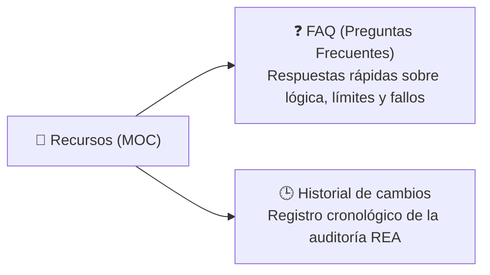

# 🧰 Recursos

> [!abstract] En pocas palabras
> Esta sección agrupa los recursos de apoyo de la base de conocimiento **ClippersIppers**: las preguntas frecuentes (**[[FAQ]]**) con respuestas directas sobre el comportamiento interno de **OpusClip Dashboard** y el **[[Historial de cambios]]** de esta investigación.

El diagrama muestra las dos notas de consulta rápida que cierran la estructura del vault.

> [!example] Ejemplo real: Resolver dudas técnicas en segundos
> En [[FAQ]] encontrarás respuestas directas con referencia al módulo exacto a preguntas como: *"¿Por qué el dashboard ejecuta un benchmark de CPU?"*, *"¿Cómo puedo forzar el Dashboard Clásico si me activaron OpusClip 4.0?"* o *"¿Cuánto tiempo guarda OpusClip el historial de videos escalados?"*.

---

## 📑 Notas de esta sección

| Nota | Qué encontrarás ahí |
|---|---|
| [[FAQ]] | 10 preguntas y respuestas verificadas en el código sobre el funcionamiento interno, trucos de depuración, límites de tiempo y reglas financieras de OpusClip. |
| [[Historial de cambios]] | Bitácora de versiones del análisis REA y de la construcción del vault. |

---

> [!info]- Detalle técnico (para desarrolladores)
> Si necesitas buscar un término específico en todo el proyecto, recuerda consultar también el [[Glosario]] en la sección `10 - Visión general`.

## 🔗 Relacionado
- [[00 - Inicio]] — Portada principal del vault.
- [[Glosario]] — Definiciones de todos los términos técnicos y de negocio.
- [[Registro de Evidencia REA]] —Respaldo empírico de las respuestas del FAQ.
