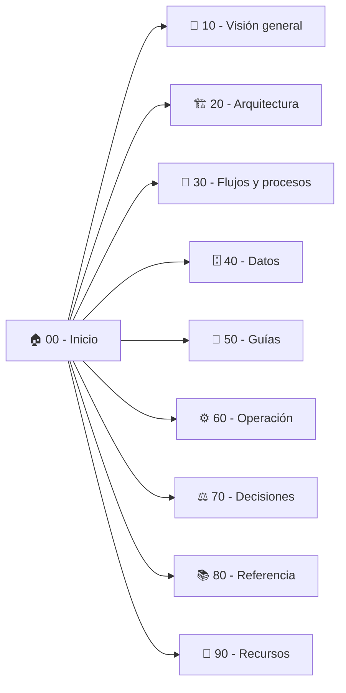

# 📚 Doc - Proyectos (Vaults de Obsidian)

Repositorio central de documentación técnica, funcional y de arquitectura de proyectos, estructurado bajo el modelo de **Vaults independientes de Obsidian** (un proyecto por carpeta).

---

## 🎯 Propósito del Repositorio

Este repositorio actúa como la fuente única de verdad (*Single Source of Truth*) para las bases de conocimiento de desarrollo, ingeniería inversa asistida por IA (REA), arquitectura de software y operación.

Cada carpeta de proyecto es un **vault de Obsidian autónomo** con su propia configuración interna (`.obsidian/`), permitiendo abrir los proyectos de manera individual o mantenerlos versionados de forma unificada.

---

## 🗂️ Catálogo de Proyectos Documentados

| Proyecto | Descripción | Estado | Punto de entrada |
|---|---|---|---|
| **[ClippersIppers](./ClippersIppers)** | Documentación e ingeniería inversa de **OpusClip Dashboard** (`clip.opus.pro/dashboard`). Pipeline de subtítulos 1080p, contratos de API, decodificación de plantillas y arquitectura de clipping inteligente. | En producción | [`00 - Inicio.md`](./ClippersIppers/00%20-%20Inicio.md) · [`Canvas`](./ClippersIppers/Mapa%20del%20proyecto.canvas) |
| **[VidForge Studio](./VidForge%20Studio)** | Suite local de producción audiovisual asistida por IA para Windows x64. Reconstrucción Clean-Room con FastAPI, sidecar de renderizado FFmpeg NVENC, alineador ASR y exportador a CapCut Desktop / OTIO. | En producción local (`v1.0.0`) | [`00 - Inicio.md`](./VidForge%20Studio/00%20-%20Inicio.md) · [`Canvas`](./VidForge%20Studio/Mapa%20del%20proyecto.canvas) |

---

## 📐 Estructura Estándar de Cada Vault (10 - 90)

Cada proyecto dentro del repositorio sigue una taxonomía numérica estandarizada para garantizar coherencia, facilidad de lectura y navegación rápida:

- **`00 - Inicio.md`**: Página principal con resumen ejecutivo, ficha técnica y tabla de rutas de lectura según rol (negocio, técnico, soporte, analista).
- **`10 - Visión general`**: Objetivos, alcance, actores, métricas clave y glosario inicial.
- **`20 - Arquitectura`**: Diagramas C4/Mermaid, componentes de software, integraciones externas y límites técnicos.
- **`30 - Flujos y procesos`**: Flujos de usuario, diagramas de secuencia e interacciones paso a paso.
- **`40 - Datos`**: Modelos de datos, contratos JSON, esquemas de bases de datos y KPIs.
- **`50 - Guías`**: Guías paso a paso (*how-to*) orientadas a resolver tareas y primeros pasos.
- **`60 - Operación`**: Despliegue, configuración de entornos, monitoreo y runbooks de respuesta a incidentes.
- **`70 - Decisiones`**: Registros de Decisiones Arquitecturales (ADR) con contexto, opciones evaluadas y consecuencias.
- **`80 - Referencia`**: Especificación de endpoints de API, parámetros de configuración y catálogos de contratos.
- **`90 - Recursos`**: Glosario integral, preguntas frecuentes (FAQ) e historial cronológico de cambios.
- **`Mapa del proyecto.canvas`**: Lienzo interactivo visual de Obsidian que mapea las notas y sus dependencias.

---

## 🚀 Cómo Explorar en Obsidian

1. Abre **Obsidian**.
2. En la pantalla de inicio o selector de bóvedas, haz clic en **"Abrir carpeta como vault"** (*Open folder as vault*).
3. Selecciona la carpeta del proyecto específico que desees consultar:
   - `D:\Doc - Proyectos\ClippersIppers`
   - `D:\Doc - Proyectos\VidForge Studio`
4. Comienza la lectura desde **`00 - Inicio.md`** o interactúa visualmente con **`Mapa del proyecto.canvas`**.

> [!TIP]
> Al mantener cada proyecto como un vault separado, los enlaces internos con formato `[[wikilink]]` se resuelven de forma limpia y contextual dentro del dominio de cada producto.

---

## 🛡️ Buenas Prácticas y Convención Git

- **Commits atómicos**: Cada commit afecta a un solo proyecto o a la configuración raíz del repositorio.
- **Convención de mensajes**: `tipo(proyecto): descripción`
  - Tipos válidos: `docs`, `feat`, `fix`, `refactor`, `style`, `chore`, `revert`.
  - Ejemplos: `docs(vidforge-studio): actualiza runbook de sidecar`, `chore(vault): configura git para obsidian`.
- **Hooks de seguridad**: El repositorio cuenta con hooks automatizados (`pre-commit` y `commit-msg`) que bloquean la subida de secretos (tokens, contraseñas, llaves API) y validan el estándar del mensaje.
