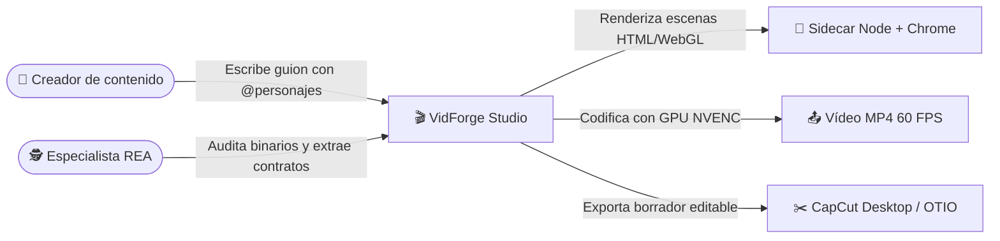

# 🏠 VidForge Studio

> [!abstract] En pocas palabras
> Suite local de producción audiovisual con inteligencia artificial para Windows x64, nacida de la ingeniería inversa asistida por [[Glosario#REA|REA]] sobre `Creator-IA 2.0` y reconstruida desde cero (*[[Glosario#Clean-Room|Clean-Room]]*) para convertir un guion de texto en un vídeo MP4 a 60 FPS o en un proyecto editable de [[Glosario#CapCut Desktop|CapCut Desktop]] en minutos.

| 📌 Estado | 👤 Responsable | 🗓️ Actualizado | 🔗 Repositorio / origen |
|---|---|---|---|
| En producción local (`v1.0.0`) | SebzSGC | 2026-10-18 | `D:/rea-projects` |

## 🧭 ¿Por dónde empiezo?

| Si eres… | Lee primero | Luego |
|---|---|---|
| 👩‍💼 De negocio / directivo | [[Resumen ejecutivo]] | [[Indicadores y métricas]] |
| 🆕 Nuevo en el equipo | [[Primeros pasos]] | [[Arquitectura general]] |
| 🛠️ Técnico que da soporte | [[Operación]] | [[Monitoreo y diagnóstico]] |
| 🕵️ Analista de ingeniería inversa | [[Especialista REA y Auditoría Forense]] | [[Flujo de ingeniería inversa con REA]] |
| 🤔 Buscas un término o duda | [[Glosario]] | [[FAQ]] |

## 🗺️ El proyecto de un vistazo

Vista completa e interactiva: ![[Mapa del proyecto.canvas]]

## 📚 Secciones

- 🎯 [[Visión general]] — qué hace el ecosistema, su origen forense, alcance, actores y glosario
- 🏗️ [[Arquitectura]] — cómo están construidos VidForge Studio y la integración MCP de REA
- 🔄 [[Flujos y procesos]] — qué ocurre paso a paso desde el guion o la auditoría binaria hasta el vídeo final
- 📊 [[Datos]] — base de datos SQLite WAL, contratos JSON Schema e indicadores de rendimiento
- 🧭 [[Guías]] — tutoriales prácticos para ejecutar la suite, crear vídeos y auditar binarios
- 🚑 [[Operación]] — empaquetado Inno Setup, verificación SHA-256, diagnóstico y runbooks de soporte
- ⚖️ [[Decisiones]] — por qué se eligió FastAPI, SQLite + `.vfproj` y wrappers `.cmd` para MCP
- 📖 [[Referencia]] — catálogo de endpoints REST/SSE (`/api/v1`) y plantillas animadas
- 🗂️ [[Recursos]] — preguntas frecuentes e historial de versiones

## 🔔 Novedades recientes

- **2026-10-18** — Creación del vault integral de documentación de **VidForge Studio** y **REA Windows Specialist** → [[Historial de cambios]]
- **2026-10-16** — Finalización de las Fases 1 a 5 de reconstrucción *Clean-Room* de **VidForge Studio v1.0.0** y auditoría forense de `Creator-IA 2.0 (a5)` → [[Historial de cambios]]
