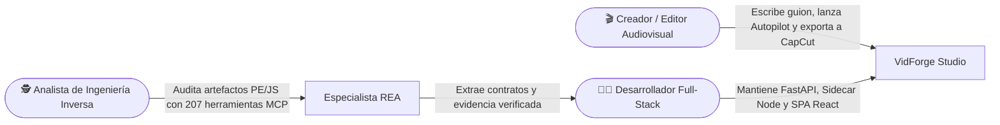

# 👥 Actores y responsables

> [!abstract] En pocas palabras
> Quién utiliza **VidForge Studio** y el entorno **[[Glosario#REA|REA]]**, qué hace cada perfil dentro del flujo de trabajo y a quién acudir cuando hay que cambiar código, auditar un binario o resolver un incidente.

## 👤 Perfiles que interactúan con el proyecto

| Perfil / Rol | Quién es | Qué hace en el sistema | Espacio que más usa |
|---|---|---|---|
| **Creador / Editor Audiovisual** | Usuario final de negocio o contenido | Redacta el guion con etiquetas `@Personaje`, procesa locuciones en [[Glosario#AudioLab|AudioLab]], ejecuta el modo Autopilot y exporta el vídeo MP4 o el borrador a [[Glosario#CapCut Desktop|CapCut Desktop]] | Ventana nativa de **VidForge Studio** (`Iniciar-VidForge.bat`) |
| **Desarrollador / Mantenedor** | **SebzSGC** (`sebzsgc@gmail.com`) | Desarrolla y mantiene el backend FastAPI, el sidecar de renderizado en Node.js, las plantillas HTML/SVG y la suite de pruebas | `d:\rea-projects\vidforge\` |
| **Especialista en Ingeniería Inversa (REA)** | Agente `rea-specialist` / Analista técnico | Ejecuta diagnósticos `rea doctor`, inspecciona recursos PE32+, analiza AST de JavaScript/Electron y verifica integridad SHA-256 | Google Antigravity + `d:\rea-projects\projects\` |
| **Soporte Operativo Local** | Administrador de la estación Windows | Verifica drivers NVIDIA ([[Glosario#NVENC|NVENC]]), revisa logs en `storage/logs`, limpia temporales y ejecuta `verify-install.py` | `60 - Operación` y [[Monitoreo y diagnóstico]] |

## 📋 Matriz RACI de responsabilidades

**R** = Responsable (lo ejecuta) · **A** = Aprueba · **C** = Consultado · **I** = Informado

| Actividad | Creador Audiovisual | Desarrollador (`SebzSGC`) | Especialista REA | Soporte Operativo |
|---|:-:|:-:|:-:|:-:|
| Crear guion, generar escenas y exportar vídeo / CapCut | **R** | I | – | C |
| Diseñar o modificar plantillas HTML/SVG y shaders [[Glosario#WebGL|WebGL]] | C | **R / A** | – | I |
| Auditar un binario externo o paquete nuevo con REA | I | A | **R** | C |
| Actualizar contratos JSON Schema y pruebas `pytest` | – | **R / A** | C | I |
| Resolver fallos de codificación GPU (`h264_nvenc`) o Sidecar | I | C | – | **R / A** |
| Empaquetar instalador Inno Setup y firmar `MANIFEST.json` | I | **R / A** | C | C |

> [!example] Ejemplo de colaboración entre roles
> Durante la creación del exportador de borradores de CapCut (`services/export.py`), el **Especialista REA** extrajo de forma estática la estructura requerida por `draft_content.json` y `draft_meta_info.json` desde los binarios de referencia, el **Desarrollador** codificó el contrato `capcut-draft-subset.v1.json` y el validador en Python, y el **Creador Audiovisual** obtiene con un clic la carpeta lista con sus archivos en `Resources/`.

## 📞 Contacto y escalamiento

| Necesidad | Responsable | Contacto / Referencia |
|---|---|---|
| Cambios de arquitectura, API o plantillas | **SebzSGC** | `sebzsgc@gmail.com` · [[Arquitectura general]] |
| Fallo al renderizar vídeo o abrir WebView2 | Soporte técnico / **SebzSGC** | [[Runbook · Fallo en Sidecar o FFmpeg NVENC]] |
| Herramientas MCP de REA no aparecen en Antigravity | Especialista REA / **SebzSGC** | [[Runbook · Herramientas MCP de REA no disponibles]] |

## 🔗 Relacionado

- [[00 - Inicio]] · [[Resumen ejecutivo]] · [[Alcance y objetivos]] · [[Operación]]
