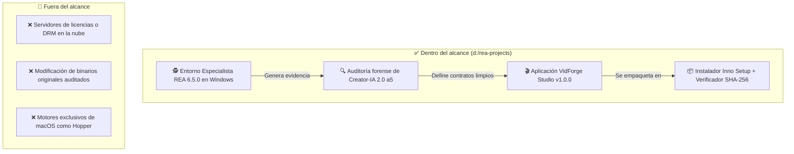

# 🎯 Alcance y objetivos

> [!abstract] En pocas palabras
> Define qué abarca el ecosistema **VidForge Studio** (tanto la plataforma de generación de vídeo con IA como la estación de ingeniería inversa con [[Glosario#REA|REA]]), qué queda explícitamente fuera del proyecto y cómo medimos que funciona bien.

## 🎯 Objetivos del proyecto

1. **Autonomía tecnológica total (*Clean-Room*):** disponer de un generador audiovisual modular en Python, Node.js y React cuyo código fuente sea 100 % propio, legible, probado y libre de binarios opacos.
2. **Ejecución local primero (*Offline-First*):** permitir que todo el flujo de producción —desde el guion hasta el archivo `.mp4` a 60 FPS o el borrador de [[Glosario#CapCut Desktop|CapCut Desktop]]— funcione en una estación Windows x64 sin depender de conexión a internet ni suscripciones obligatorias.
3. **Capacidad forense reproducible en Windows:** mantener configurado y documentado el especialista `rea-agents@6.5.0` en Google Antigravity para auditar paquetes, instaladores y ensamblados de forma pasiva y verificable.

## 🗺️ Mapa de alcance del ecosistema

## ✅ Qué entra en el alcance

| Bloque | Qué incluye | Ubicación real |
|---|---|---|
| **1. Especialista REA en Windows** | Configuración del servidor [[Glosario#MCP|MCP]] (`rea-agents@6.5.0`, 207 herramientas), reglas operativas y *runbooks* para Windows 11 | `d:\rea-projects\AGENTS.md`, `d:\rea-projects\docs\` |
| **2. Auditoría Forense de Referencia** | Extracción estática de los 207 artefactos de `Creator-IA 2.0_a5`, inventario criptográfico SHA-256 y plan de reconstrucción en 5 fases | `d:\rea-projects\projects\01-generadorVideos\` |
| **3. Backend y Motor de Trabajos** | Servidor FastAPI (`/api/v1/*`), base de datos [[Glosario#SQLite WAL|SQLite WAL]], cola asíncrona por recurso (`gpu`, `cpu`, `net`, `io`), [[Glosario#AudioLab|AudioLab]] y bóveda cifrada con [[Glosario#DPAPI|DPAPI]] + [[Glosario#AES-256-GCM|AES-256-GCM]] | `d:\rea-projects\vidforge\apps\backend\` |
| **4. Sidecar de Renderizado y Plantillas** | Proceso Node.js (`sidecar.mjs`) con `puppeteer-core`, 6 plantillas HTML/CSS/SVG con transparencia VP9 y 4 shaders [[Glosario#WebGL|WebGL]] GLSL | `d:\rea-projects\vidforge\apps\render-sidecar\`, `packages\templates\` |
| **5. Interfaz Studio y Lanzador Nativo** | Aplicación React 18 con 5 espacios de trabajo, modo Autopilot 1-Click y ventana nativa [[Glosario#WebView2|WebView2]] (`pywebview`) sin consola negra | `d:\rea-projects\vidforge\apps\web\`, `apps\launcher\` |
| **6. Contratos, Pruebas e Instalador** | 9 esquemas JSON Schema 2020-12, suite `pytest` + `hypothesis`, manifiesto `MANIFEST.json` y script [[Glosario#Inno Setup|Inno Setup]] (`vidforge.iss`) | `d:\rea-projects\vidforge\packages\contracts\`, `installer\` |

## 🚫 Qué NO entra en el alcance

- **Telemetría, DRM o validación de licencias en la nube:** a diferencia del binario analizado (`license_client.pyd` conectado a Supabase), VidForge Studio no rastrea el `MachineGuid` ni bloquea funciones por suscripción.
- **Ejecución o alteración de los binarios originales de `Creator-IA 2.0`:** toda la carpeta `projects/01-generadorVideos/Creator-IA-2.0_a5` se mantiene intacta como evidencia forense de solo lectura.
- **Automatización de navegadores externos mediante sesiones robadas:** se descartó replicar `browser_ai.pyd` (automatización no oficial de interfaces web de terceros) en favor de conectores API limpios y motores locales.

> [!example] Ejemplo de criterio de alcance
> Cuando el guion menciona una cifra como `"creció un 87%"`, **sí entra en el alcance** validar automáticamente que el número `87%` exista en la locución antes de renderizar la tarjeta animada (`validate_motion_semantics`). En cambio, **no entra en el alcance** editar cuadro por cuadro curvas Bézier tridimensionales como en Adobe After Effects: para ajustes finos de postproducción, VidForge exporta el proyecto directo a [[Glosario#CapCut Desktop|CapCut Desktop]].

## 📊 Criterios de éxito

- **Verificación de instalación:** `verify-install.py` comprueba el 100 % de los **78 archivos clave** contra sus hashes SHA-256 en menos de 2 segundos.
- **Alineación sin solapes:** toda transcripción generada garantiza tiempos monótonos crecientes (`start_us < end_us`) sin superposición entre palabras consecutivas.
- **Compatibilidad CapCut:** todo borrador exportado valida sin errores contra el esquema `capcut-draft-subset.v1.json`.

## 🔗 Relacionado

- [[Resumen ejecutivo]] · [[Actores y responsables]] · [[Indicadores y métricas]] · [[ADR-001 Reconstrucción Clean-Room con FastAPI y Sidecar ESM]]
