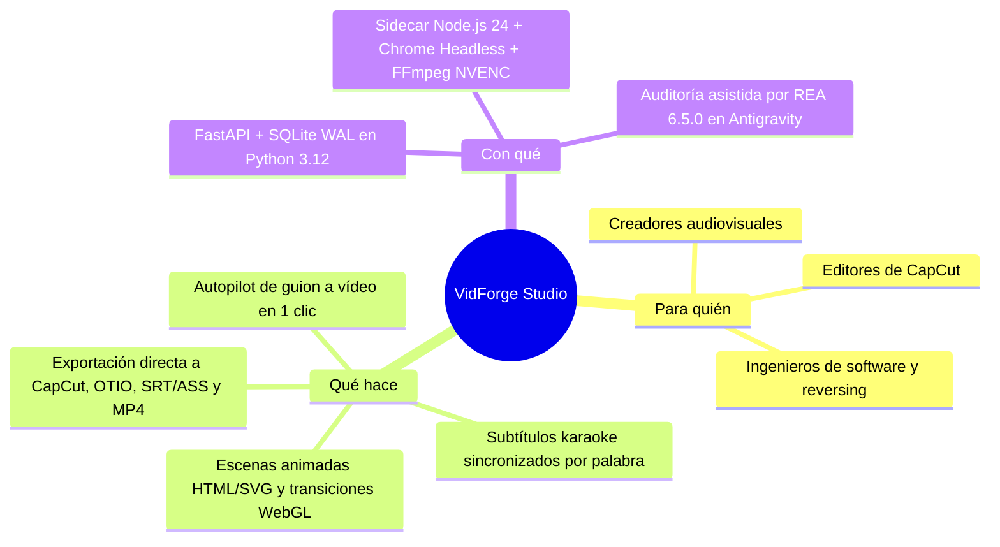

# 🎯 Resumen ejecutivo

> [!abstract] En pocas palabras
> **VidForge Studio** automatiza la creación de vídeos profesionales en Windows a partir de un texto escrito, sin depender de servidores externos ni licencias cerradas. Nació tras auditar `Creator-IA 2.0` con el especialista [[Glosario#REA|REA]] y reconstruir toda su capacidad en código limpio, abierto y auditable.

## ❓ El problema

Producir un vídeo dinámico con locución, subtítulos sincronizados palabra por palabra, gráficas animadas y efectos de cámara suele requerir entre **2 y 4 horas de edición manual** por cada pieza de 1 minuto.

Por otro lado, la herramienta comercial previa analizada en el laboratorio (`Creator-IA 2.0_a5`, paquete de `658 MB` con `41.201` archivos) presentaba tres obstáculos críticos:
1. **Caja negra compilada y ofuscada:** su lógica estaba encerrada en 15 binarios nativos [[Glosario#Nuitka|Nuitka]] (`.pyd`) y código JavaScript ofuscado, impidiendo dar mantenimiento o corregir fallos.
2. **Dependencia de servidores externos:** exigía validación remota constante y bloqueaba el arranque ante cualquier archivo nuevo en su carpeta.
3. **Acoplamiento monolítico:** un único archivo (`server.pyd` de `6.86 MB`) concentraba 193 rutas HTTP sin separación clara de responsabilidades ni pruebas automatizadas.

## ✅ La solución

El proyecto aborda el problema en dos eslabones complementarios dentro del workspace `d:\rea-projects`:

1. **Laboratorio de Ingeniería Inversa ([[Especialista REA y Auditoría Forense|Especialista REA]]):** integra `rea-agents@6.5.0` (207 herramientas [[Glosario#MCP|MCP]]) con Google Antigravity en Windows 11 para inspeccionar binarios PE32+, desempaquetar instaladores [[Glosario#Inno Setup|Inno Setup]] en modo seguro (solo lectura) y documentar contratos funcionales sin ejecutar código desconocido.
2. **Aplicación Propia Reconstruida (VidForge Studio):** una suite de escritorio y web local (*[[Glosario#Clean-Room|Clean-Room]]*) que toma un guion con etiquetas de personajes (`@Elena`), genera locución [[Glosario#TTS|TTS]], alinea cada palabra con precisión de microsegundos, inserta escenas animadas HTML/SVG con canal transparente y exporta tanto el vídeo **MP4 a 60 FPS** acelerado por [[Glosario#NVENC|NVENC]] como el borrador nativo para **[[Glosario#CapCut Desktop|CapCut Desktop]]**.

## 📈 Beneficios y resultados

| Indicador | Antes (`Creator-IA 2.0` / Manual) | Ahora con VidForge Studio |
|---|---|---|
| **Tiempo para armar borrador de 1 min** | 45–90 min manual | **< 25 segundos** con [[Flujo de Autopilot en un clic\|Autopilot 1-Click]] |
| **Mantenibilidad del código** | 0 % (15 binarios `.pyd` cerrados + JS ofuscado) | **100 % código fuente limpio**, tipado y validado con contratos JSON Schema |
| **Superficie de API HTTP** | 193 rutas acopladas en Flask/Waitress | **28 endpoints REST + [[Glosario#SSE\|SSE]]** modulares en FastAPI (`/api/v1/*`) |
| **Operación sin internet (Offline)** | Bloqueada sin servidor de licencias remoto | **100 % operativa offline** (TTS local, alineación local, renderizado local) |
| **Integridad verificable** | Manual o cerrada | **78 archivos auditados con SHA-256** (`MANIFEST.json`) + suite `pytest`/`hypothesis` |

> [!example] Ejemplo real en el proyecto
> Al crear un proyecto nuevo en VidForge Studio con el guion *"En el último año el rendimiento creció un 87% gracias a la automatización local. @Elena explica cómo el flujo tradicional versus el nuevo motor reduce los tiempos a la mitad"*, el botón **Autopilot 1-Click** divide el texto en 3 escenas (*beats*), detecta a `@Elena`, genera la voz en `.wav`, detecta el número `87%` e inserta automáticamente la plantilla animada `stat-highlight` sincronizada con la voz.

## 👥 Quiénes participan

El proyecto es operado y mantenido por el equipo de desarrollo e ingeniería inversa en Windows. Consulta el detalle de roles y responsabilidades en [[Actores y responsables]].

## 🚦 Estado actual y próximos pasos

- **Estado:** Vigente y funcional (`v1.0.0`), con las **5 fases de reconstrucción completadas** y verificadas mediante pruebas automatizadas.
- **Próximo hito:** Aprovisionamiento opcional de [[Glosario#Ghidra|Ghidra]] (`12.1.x` + JDK 21) en el entorno REA si se requieren descompilaciones adicionales de motores C++ nativos, y actualización menor de Node.js a `>= 24.15.0` para habilitar el inspector SQLite nativo de REA.

## ⚠️ Riesgos o limitaciones conocidas

- **Restricción de Ghidra en Windows:** el puente de Ghidra en REA sobre Windows opera únicamente en modo de solo lectura (sin mutación de nombres o comentarios en la base de datos nativa).
- **Bloqueo de CapCut Desktop durante la exportación:** si `CapCut.exe` está abierto mientras se escribe un borrador en su carpeta de proyectos, puede sobrescribir los cambios; por ello VidForge verifica el proceso activo antes de exportar.

## 🔗 Relacionado

- [[00 - Inicio]] · [[Alcance y objetivos]] · [[Actores y responsables]] · [[Arquitectura general]] · [[Indicadores y métricas]]
