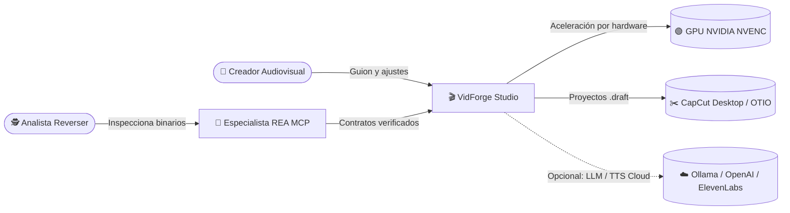
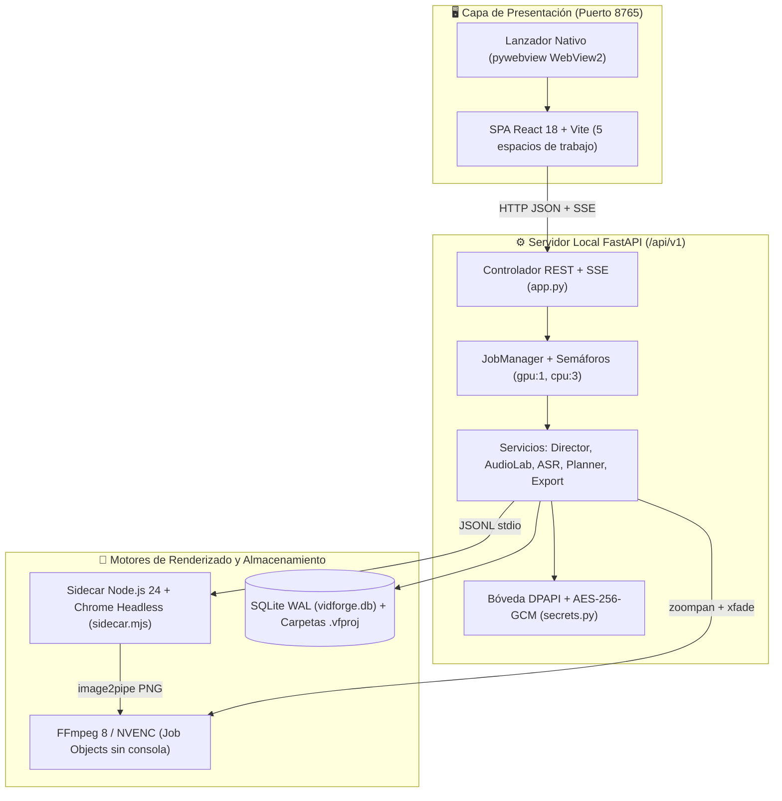

# 🏗️ Arquitectura general

> [!abstract] En pocas palabras
> El proyecto funciona como un edificio de tres plantas aisladas y seguras en tu computador: arriba está la ventana visual donde escribes el guion (**React + [[Glosario#WebView2|WebView2]]**), en el medio el cerebro que organiza las tareas (**FastAPI + [[Glosario#SQLite WAL|SQLite WAL]]**) y abajo los motores pesados que dibujan y comprimen el vídeo (**[[Glosario#Sidecar|Sidecar]] Node.js + FFmpeg [[Glosario#NVENC|NVENC]]**). Al lado opera el laboratorio **[[Glosario#REA|REA]]** para auditar binarios.

## 🗺️ Nivel 1 · Contexto (para todos)

¿Quién usa el sistema y con qué piezas de tu computador o de internet se comunica?

## 🧱 Nivel 2 · Piezas principales (contenedores)

| Pieza | Qué hace (en llano) | Tecnología | Nota de detalle |
|---|---|---|---|
| **Especialista REA** | Inspecciona binarios PE, `.NET` y JS/Electron mediante 207 herramientas [[Glosario#MCP\|MCP]] | `rea-agents@6.5.0` sobre Node.js 24 | [[Especialista REA y Auditoría Forense]] |
| **Lanzador e Interfaz Web** | Muestra los 5 espacios de edición en una ventana nativa sin consola negra | `pywebview` (Edge WebView2) + React 18 | [[Interfaz Web Studio y Lanzador Nativo]] |
| **Servidor Backend y Cola** | Expone `/api/v1/*`, coordina trabajos sin saturar la GPU y protege claves | Python 3.12 + FastAPI + Uvicorn | [[Servidor Backend y Gestor de Trabajos]] |
| **Alineador y Planificador** | Sincroniza cada palabra con el audio y arma la línea de tiempo sin huecos | `RapidFuzz` + Needleman-Wunsch + VAD | [[Alineador ASR y Planificador de Timeline]] |
| **Sidecar y Motor FFmpeg** | Captura plantillas HTML/SVG transparentes, aplica shaders [[Glosario#WebGL\|WebGL]] y codifica MP4 | Node.js 24 + `puppeteer-core` + FFmpeg | [[Sidecar de Renderizado y Motor FFmpeg]] |
| **Almacenamiento Híbrido** | Guarda el índice global en SQLite y cada proyecto en su carpeta `.vfproj` | SQLite (`WAL`) + JSON Schema 2020-12 | [[Modelo de datos]] |

## ⚙️ Cómo se comunican

1. **Interfaz ↔ Backend (`HTTP + SSE`):** cuando el usuario pulsa un botón (por ejemplo, **Autopilot 1-Click**), la SPA envía un `POST /api/v1/projects/{id}/autopilot` a `http://127.0.0.1:8765`. El servidor devuelve de inmediato el identificador del trabajo (`job_id`) y transmite el progreso en tiempo real por `GET /api/v1/events` ([[Glosario#SSE|SSE]]).
2. **Backend ↔ Sidecar Node (`request.json + JSONL`):** para renderizar una escena animada, Python escribe un archivo temporal `request.json` con el protocolo `vidforge.render/1`, lanza `node.exe sidecar.mjs` oculto y lee líneas JSON (`{"type": "progress", "frame": 45, "total": 120}`) desde su salida estándar.
3. **Sidecar ↔ FFmpeg (`image2pipe` en memoria):** Chrome Headless captura cada fotograma en PNG con transparencia alfa y lo inyecta directamente por tubería (`stdin`) a FFmpeg, sin escribir miles de imágenes sueltas en el disco duro.

> [!example] Ejemplo concreto de comunicación extremo a extremo
> Cuando pides renderizar la plantilla `stat-highlight` con el dato `"87%"` por `4 segundos` a `30 FPS`, FastAPI valida primero que `"87%"` aparezca en el guion hablado (`validate_motion_semantics`). Luego encola un trabajo en el *pool* `gpu`, invoca `sidecar.mjs`, este abre `packages/templates/stat-highlight/index.html`, captura `120 fotogramas` transparentes y entrega `motion_stat-highlight_a1b2c3.webm` codificado en `libvpx-vp9` con `alpha_mode=1`.

> [!info]- Detalle técnico
> - **Aislamiento de procesos en Windows:** `vidforge/apps/backend/src/vidforge/infra/procs.py` aplica `CREATE_NO_WINDOW (0x08000000)` y vincula todos los subprocesos (`ffmpeg.exe`, `ffprobe.exe`, `node.exe`) a un [[Glosario#Job Object|Job Object]] con `JOB_OBJECT_LIMIT_KILL_ON_JOB_CLOSE`.
> - **Matemática exacta de transiciones (`xfade`):** `compute_xfade_schedule` en `services/render.py` compensa la pérdida de duración de FFmpeg `xfade` extendiendo cada clip $i < n-1$ en $d_i = s_i + t_{i+1}$ microsegundos, garantizando que $\sum d_i - \sum t_k = \sum s_i$.
> - **Decisiones arquitectónicas:** consulta [[ADR-001 Reconstrucción Clean-Room con FastAPI y Sidecar ESM]], [[ADR-002 Almacenamiento híbrido SQLite WAL y carpetas vfproj]] y [[ADR-003 Integración MCP de REA en Windows mediante wrappers cmd]].

## 🌐 Entornos

| Entorno | Para qué sirve | Ubicación / URL | Datos que maneja |
|---|---|---|---|
| **Escritorio Nativo (Producción local)** | Uso diario en ventana dedicada WebView2 | `d:\rea-projects\vidforge\Iniciar-VidForge.bat` (`127.0.0.1:8765`) | Proyectos reales en `storage/projects/*.vfproj` |
| **Servidor Web Local** | Uso desde Chrome/Edge estándar o depuración | `d:\rea-projects\vidforge\Iniciar-Servidor-Web.bat` (`http://127.0.0.1:8765`) | Misma base `storage/userdata/vidforge.db` |
| **Desarrollo Frontend (Vite)** | Edición en caliente de la interfaz React | `http://127.0.0.1:5173` (CORS habilitado hacia `:8765`) | Proyectos de prueba |
| **Laboratorio Forense REA** | Auditoría estática de binarios en Antigravity | `d:\rea-projects\projects\01-generadorVideos\` | Evidencias en modo solo lectura |

## ⚠️ Puntos débiles conocidos y mitigaciones

- **Concurrencia de GPU:** ejecutar varios renders NVENC o modelos Whisper en paralelo puede agotar la memoria VRAM. **Mitigación aplicada:** el `JobManager` restringe el semáforo del pool `gpu` a **1 tarea simultánea** (`limits = {"gpu": 1, "cpu": 3, "net": 4, "io": 2}`).
- **Políticas de PowerShell en Windows:** Windows bloquea por defecto la ejecución de scripts `.ps1` como `npx.ps1`. **Mitigación aplicada:** tanto los lanzadores de VidForge como el servidor MCP de REA utilizan invocadores `.bat` / `cmd.exe /d /c npx`.

## 🔗 Relacionado

- [[00 - Inicio]] · [[Integraciones]] · [[Modelo de datos]] · [[Despliegue e instalador]] · [[Decisiones]]
