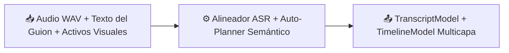

# 🧩 Alineador ASR y Planificador de Timeline

> [!abstract] En pocas palabras
> Es el "director de montaje" inteligente de **VidForge Studio**: escucha la locución, calcula en qué microsegundo exacto se pronuncia cada palabra del guion ([[Glosario#Alineación forzada|alineación forzada]]) y arma automáticamente las 4 pistas de la línea de tiempo (vídeo, gráficas animadas, subtítulos [[Glosario#ASS|ASS]] karaoke y audio) sin dejar huecos ni solapes.

## 📥 Recibe → ⚙️ Hace → 📤 Entrega



| | Descripción | Ejemplo real en este proyecto |
|---|---|---|
| 📥 **Entrada** | Archivo de voz (`narration.wav`), texto del guion (`script.json`) y lista de imágenes/vídeos generados | Locución de `12,4 s` con 34 palabras y 3 imágenes de escena |
| 📤 **Salida** | `TranscriptModel` con tiempos por palabra en microsegundos, subtítulos `.srt`/`.vtt`/`.ass` y `TimelineModel` de 4 pistas | `timeline.json` con `duration_us: 12400000`, `track_video`, `track_motion`, `track_subs` y `track_audio` |

## 💡 Ejemplo paso a paso

> [!example] Alineación de palabras y detección automática de gráfica animada
> 1. `transcribe_or_align` (`services/asr.py`) mide la duración exacta del audio con `ffprobe` y detecta los intervalos de silencio reales (`silencedetect` a `-35 dB`).
> 2. Si `faster-whisper` está activo, transcribe las palabras y las reconcilia contra el guion escrito usando el algoritmo **Needleman-Wunsch** con similitud difusa `RapidFuzz` (`reconcile_script_with_asr_words`). Si opera en modo ligero offline, reparte las palabras sobre los intervalos hablados ponderando su longitud y garantizando monotonía estricta (`start_us < end_us`).
> 3. `group_words_into_segments` agrupa las palabras en segmentos de lectura cómoda (máximo 8 palabras o hasta el signo de puntuación).
> 4. `build_auto_timeline` (`services/planner.py`) recorre cada segmento, asigna un clip visual sin huecos (*gapless*), alterna direcciones de [[Glosario#Ken Burns|Ken Burns]] y transiciones (`fade`, `wipeleft`, `smoothleft`, `fadeblack`) y, al detectar `"87%"` en el texto, inserta un clip en `track_motion` con la plantilla `stat-highlight`.
> **Resultado:** Una línea de tiempo completa y validada en menos de 1 segundo, lista para reproducirse en el editor o exportarse a [[Glosario#CapCut Desktop|CapCut Desktop]].

## 🔌 Depende de / lo usan

- **Depende de:** `rapidfuzz`, `numpy`, `soundfile`, `services/audio.py` (`detect_silences`, `probe_media`) y el catálogo de plantillas en `packages/templates/*/manifest.json`.
- **Lo usan:** [[Servidor Backend y Gestor de Trabajos]], [[Flujo de Autopilot en un clic]] y [[Flujo de exportación a CapCut y OTIO]].

> [!info]- Detalle técnico
> - **Garantía de monotonía y no solape (`services/asr.py`):**
> ```python
> last_end = 0
> for w_obj in result:
>     if w_obj.start_us < last_end:
>         w_obj.start_us = last_end
>     if w_obj.end_us <= w_obj.start_us:
>         w_obj.end_us = min(duration_us, w_obj.start_us + 80_000)
>     last_end = w_obj.end_us
> ```
> - **Validación semántica *Fail-Closed* (`validate_motion_semantics` en `services/planner.py`):**
>   Antes de permitir renderizar una escena animada asociada a una locución, comprueba las reglas declaradas en el `manifest.json` de la plantilla:
>   - `numbers_must_appear_in_speech`: toda cifra mostrada en pantalla (ej. `87%`) debe existir en el texto hablado.
>   - `text_must_be_substring_fuzzy`: el texto de la tarjeta debe tener similitud parcial $\ge$ umbral con el guion (`fuzz.partial_ratio`).
>   - `requires_two_entities`: en comparativas (`comparison-vs`), exige que `left_title` y `right_title` no estén vacíos.
> - **Invariantes del Timeline (`validate_timeline_invariants`):** verifica que `duration_us > 0`, que ningún clip tenga duración $\le 0$ y que no existan solapes en la pista de vídeo principal.

## ⚠️ Cuidado al modificar

- **Toda unidad de tiempo interna está en microsegundos (`int`):** `1 segundo = 1_000_000 us`. Nunca mezcles segundos en coma flotante dentro de `WordTiming`, `ClipModel` o `TimelineModel`, ya que rompería la compatibilidad con los esquemas JSON y con el exportador de CapCut.

## 🔗 Relacionado

- [[Arquitectura general]] · [[Modelo de datos]] · [[Flujo de Autopilot en un clic]] · [[Catálogo de plantillas y contratos JSON]]
