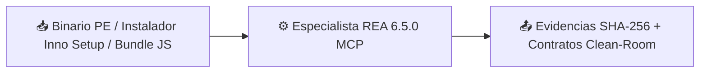

# 🧩 Especialista REA y Auditoría Forense

> [!abstract] En pocas palabras
> Es el laboratorio de ingeniería inversa del proyecto: conecta **Google Antigravity** con las 207 herramientas de **[[Glosario#REA|REA]] (`rea-agents@6.5.0`)** en Windows 11 para analizar programas empaquetados sin ejecutarlos. Gracias a este componente se auditó `Creator-IA 2.0` y se obtuvieron los planos exactos para construir **VidForge Studio**.

## 📥 Recibe → ⚙️ Hace → 📤 Entrega



| | Descripción | Ejemplo real en este proyecto |
|---|---|---|
| 📥 **Entrada** | Ejecutables Windows (`.exe`, `.dll`, `.pyd`), instaladores o paquetes `.asar`/JS | `Creator-IA-2.0_a5-Setup.exe` (`22,8 MB`) + `Setup-1.bin` (`635,6 MB`) |
| 📤 **Salida** | Hashes SHA-256 verificados, recursos PE, árboles AST, rutas HTTP y plan de reconstrucción | `projects/01-generadorVideos/analisis/INFORME.md` (207 artefactos verificados bit a bit) |

## 💡 Ejemplo paso a paso

> [!example] Desempaquetado y auditoría estática de `Creator-IA 2.0 (Entrega a5)`
> 1. Se verificaron en modo de solo lectura los hashes SHA-256 de `Creator-IA-2.0_a5-Setup.exe` (`ED19DB8E...`) y `Creator-IA-2.0_a5-Setup-1.bin` (`9F18DFBC...`).
> 2. Con `inspect_pe_resources` de REA se localizó el recurso `RT_RCDATA` (`ID 11111`) con los desplazamientos de [[Glosario#Inno Setup|Inno Setup]] (`Setup0Offset = 0xEE800`, `Setup1Offset = 0x0118A4F1`) y se extrajeron los 207 archivos propios revirtiendo el filtro de instrucciones x86 `CALL`/`JMP`.
> 3. Con `inspect_managed_artifact`, `inspect_go_binary` e `inspect_rust_binary` se demostró empíricamente que `Creator-IA.exe` (`288.768 bytes`) es un ejecutable nativo C/C++ MSVC x64 y que el backend estaba compuesto por 15 extensiones [[Glosario#Nuitka|Nuitka]] (`.cp313-win_amd64.pyd`).
> 4. Extrayendo los blobs de constantes de `server.cp313-win_amd64.pyd` y analizando los scripts Node con `analyze_javascript_application` (`27.038` nodos AST en `frontend/dist`), se recuperaron las **193 rutas HTTP** y los contratos de renderizado.
> **Resultado:** Especificación completa en `PLAN-EJECUCION-RECONSTRUCCION.md` que permitió programar **VidForge Studio** desde cero sin copiar una sola línea de código propietario.

## 🔌 Depende de / lo usan

- **Depende de:** Node.js `v24.14.1`, `npx.cmd`, paquete `rea-agents@6.5.0`, registro `C:\Users\sebas\.gemini\config\mcp_config.json` y skill oficial `reverse-engineer-anything` (v42).
- **Lo usan:** [[Flujo de ingeniería inversa con REA]], [[Cómo auditar binarios con REA en Windows]] y el diseño de contratos en [[Catálogo de plantillas y contratos JSON]].

> [!info]- Detalle técnico
> - **Ubicación de reglas y skills:**
>   - Reglas del workspace: `d:\rea-projects\AGENTS.md` y `d:\rea-projects\GEMINI.md`
>   - Skill adaptada a Windows: `d:\rea-projects\.agents\skills\rea-windows-specialist\SKILL.md`
>   - Subagentes configurados: `.agents/agents/rea-agent.md` y `.agents/agents/rea-specialist.md`
> - **Configuración exacta en `mcp_config.json`:**
> ```json
> {
>   "mcpServers": {
>     "rea": {
>       "command": "cmd.exe",
>       "args": ["/d", "/c", "npx", "-y", "rea-agents@6.5.0", "mcp"]
>     }
>   }
> }
> ```
> - **Matriz de motores en Windows 11:**
>   - `REA JS / Electron Static`: Operativo (integrado).
>   - `rea-dotnet-static`: Operativo (decodifica PE/CLI y CIL sin ejecutar CLR).
>   - `rea-artifact-graph`: Operativo (ZIP, AppX, MSIX, ASAR).
>   - `Hopper`: Incompatible con Windows (`unsupported_host`).
>   - `Ghidra`: Opcional (`GHIDRA_INSTALL_DIR`), opera en modo solo lectura en Windows P0.

## ⚠️ Cuidado al modificar

- **Nunca uses `npx` sin `.cmd` desde PowerShell:** la directiva `ExecutionPolicy` de Windows bloquea `npx.ps1`; usa siempre `npx.cmd` o el wrapper `cmd.exe /d /c`.
- **Preserva siempre el respaldo:** no elimines `C:\Users\sebas\.gemini\config\mcp_config.json.rea.backup`.
- **No declares `call_mcp_tool` ni rutas relativas `skills:` en el frontmatter de `.agents/agents/*.md`:** Antigravity inyecta las herramientas MCP automáticamente y falla si se incluyen nombres desconocidos en el YAML del agente.

## 🔗 Relacionado

- [[Arquitectura general]] · [[Flujo de ingeniería inversa con REA]] · [[Cómo auditar binarios con REA en Windows]] · [[ADR-003 Integración MCP de REA en Windows mediante wrappers cmd]] · [[Runbook · Herramientas MCP de REA no disponibles]]
