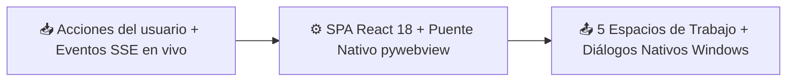

# 🧩 Interfaz Web Studio y Lanzador Nativo

> [!abstract] En pocas palabras
> Es la cara visible de **VidForge Studio**: una aplicación moderna en **React 18** que puede abrirse tanto como un programa de escritorio nativo de Windows (usando **[[Glosario#WebView2|WebView2]]** sin barras de navegador) como desde cualquier navegador web en `http://127.0.0.1:8765`, organizada en 5 estaciones de trabajo y un botón **Autopilot 1-Click**.

## 📥 Recibe → ⚙️ Hace → 📤 Entrega



| | Descripción | Ejemplo real en este proyecto |
|---|---|---|
| 📥 **Entrada** | Clics del creador, edición del guion y flujo [[Glosario#SSE\|SSE]] desde `/api/v1/events` | Clic en **Autopilot 1-Click** o cambio de transición en la pista de vídeo |
| 📤 **Salida** | Llamadas REST a `/api/v1/*`, previsualización de escenas y apertura de carpetas en el Explorador de Windows | Invocación a `window.pywebview.api.reveal_in_explorer(path)` al exportar a CapCut |

## 🧭 Los 5 espacios de trabajo de la interfaz

La interfaz (`apps/web/src/App.jsx`) guía al usuario en orden lógico de producción:

| # | Espacio de trabajo | Qué hace el usuario aquí | Endpoints principales que consume |
|---|---|---|---|
| **1** | **🎬 Director & Prompts** | Escribe el guion con etiquetas `@Personaje`, define la guía de estilo y lo divide en escenas (*[[Glosario#Beat\|beats]]*) | `GET/PUT /script`, `POST /script/segment` |
| **2** | **🎙️ Multimedia & AudioLab** | Sube archivos propios, genera locución [[Glosario#TTS\|TTS]], imágenes o clips por escena y limpia el audio (unir, recortar silencios, normalizar a `-14 LUFS`) | `POST /assets/upload`, `POST /generations`, `POST /audio/process` |
| **3** | **⚡ Sync & Plantillas** | Ejecuta la [[Glosario#Alineación forzada\|alineación forzada]] palabra por palabra, exporta subtítulos (`.srt`, `.vtt`, `.ass`) y renderiza las 6 plantillas HTML/SVG | `POST /transcripts`, `GET /templates`, `POST /motion-scenes/render` |
| **4** | **🎞️ Editor Studio** | Revisa y ajusta la línea de tiempo multipista, valida invariantes, lanza el render MP4 a 60 FPS y exporta a **[[Glosario#CapCut Desktop\|CapCut Desktop]]** u **[[Glosario#OTIO\|OTIO]]** | `GET/PUT /timeline`, `POST /timeline/autoplan`, `POST /renders`, `POST /exports` |
| **5** | **🔧 Hardware & Claves** | Inspecciona CPU, RAM y GPU [[Glosario#NVENC\|NVENC]] detectada, limpia archivos temporales y configura claves cifradas de proveedores | `GET /system/hardware`, `POST /system/cleanup-temp`, `GET/PUT /providers` |

## 💡 Ejemplo paso a paso

> [!example] Arranque nativo con `Iniciar-VidForge.bat`
> 1. El usuario hace doble clic en `d:\rea-projects\vidforge\Iniciar-VidForge.bat`.
> 2. El script invoca `pythonw.exe apps/launcher/main.py` (sin ventana de consola negra).
> 3. `main.py` registra el identificador de aplicación de Windows (`VidForge.Desktop.v1`), busca el puerto libre `8765` y arranca el servidor Uvicorn/FastAPI en un hilo demonio.
> 4. Espera hasta que `GET http://127.0.0.1:8765/api/v1/health` responda `200 OK` (menos de 1 segundo).
> 5. Abre la ventana nativa `pywebview` (`1440x900`, fondo `#090D16`) con el motor `edgechromium` y conecta el puente `DesktopJsApi` (`pick_folder` y `reveal_in_explorer`).
> **Resultado:** El usuario trabaja en una ventana nativa de Windows 11 y, al cerrar la ventana, el servidor FastAPI se apaga limpiamente.

## 🔌 Depende de / lo usan

- **Depende de:** [[Servidor Backend y Gestor de Trabajos]], `pywebview` (Microsoft Edge WebView2 Runtime) y el bundle compilado en `apps/web/dist/`.
- **Lo usan:** [[Primeros pasos]] y [[Cómo crear y exportar un vídeo con IA]].

> [!info]- Detalle técnico
> - **Puente nativo JavaScript ↔ Python (`apps/launcher/main.py`):**
> ```python
> class DesktopJsApi:
>     """Native bridge exposed to the React SPA via window.pywebview.api."""
>     def pick_folder(self) -> str | None:
>         import webview
>         res = self._window.create_file_dialog(webview.FOLDER_DIALOG)
>         return res[0] if res else None
>
>     def reveal_in_explorer(self, target_path: str) -> bool:
>         p = Path(target_path)
>         if p.exists() and sys.platform == "win32":
>             subprocess.Popen(["explorer.exe", f"/select,{str(p.resolve())}"])
>             return True
>         return False
> ```
> - **Recompilación del frontend:** si modificas `apps/web/src/App.jsx` o `styles.css`, ejecuta `npm.cmd run build` dentro de `d:\rea-projects\vidforge\apps\web` para actualizar `apps/web/dist/` y luego regenera el manifiesto con `verify-install.py --generate`.

## ⚠️ Cuidado al modificar

- **Compatibilidad dual (WebView2 y navegador normal):** antes de llamar a `window.pywebview.api` desde React, verifica siempre que `window.pywebview` exista, para que la interfaz siga funcionando igual cuando se abre desde Chrome o Edge con `Iniciar-Servidor-Web.bat`.

## 🔗 Relacionado

- [[Arquitectura general]] · [[Servidor Backend y Gestor de Trabajos]] · [[Primeros pasos]] · [[Cómo crear y exportar un vídeo con IA]]
