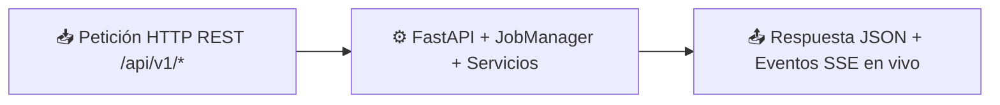

# 🧩 Servidor Backend y Gestor de Trabajos

> [!abstract] En pocas palabras
> Es el motor central de **VidForge Studio** (`FastAPI` en `127.0.0.1:8765`): recibe todas las órdenes de la pantalla, encola las tareas pesadas sin saturar la tarjeta gráfica ni el procesador, limpia el audio en [[Glosario#AudioLab|AudioLab]] y guarda las claves de forma cifrada.

## 📥 Recibe → ⚙️ Hace → 📤 Entrega



| | Descripción | Ejemplo real en este proyecto |
|---|---|---|
| 📥 **Entrada** | Petición JSON para crear proyecto, segmentar guion, procesar audio o lanzar Autopilot | `POST /api/v1/projects/8f4e.../audio/process` con `{"operation": "normalize", "target_lufs": -14.0}` |
| 📤 **Salida** | Documento del trabajo encolado (`job_doc`) y flujo continuo de eventos [[Glosario#SSE\|SSE]] | `{"id": "c7a1...", "state": "running", "progress": 0.3, "stage": "Ejecutando AudioLab (normalize)"}` |

## 💡 Ejemplo paso a paso

> [!example] Procesamiento de locución en AudioLab sin bloquear la pantalla
> 1. El usuario selecciona una pista de voz grabada y pide normalizar su volumen a `-14.0 LUFS`.
> 2. `app.py` recibe `POST /api/v1/projects/{id}/audio/process` y registra el trabajo en `JobManager` (`jobs/manager.py`) dentro del *pool* `cpu`.
> 3. El `EventBroker` publica `job.queued` y luego `job.running` por `GET /api/v1/events`.
> 4. En un hilo de fondo (`asyncio.to_thread`), `services/audio.py` ejecuta FFmpeg oculto con el filtro `loudnorm=I=-14.0:TP=-1.0:LRA=11` a `48000 Hz`.
> 5. Al terminar, inserta el nuevo activo en `vidforge.db`, lo asigna como `narration_asset_id` del proyecto y emite `job.succeeded`.
> **Resultado:** La interfaz muestra la barra al `100 %` y reproduce el nuevo audio normalizado sin congelarse ni un milisegundo.

## 🔌 Depende de / lo usan

- **Depende de:** [[Modelo de datos]] (`infra/db.py` en [[Glosario#SQLite WAL|SQLite WAL]]), `infra/secrets.py` ([[Glosario#DPAPI|DPAPI]] + [[Glosario#AES-256-GCM|AES-256-GCM]]), [[Alineador ASR y Planificador de Timeline]] y [[Sidecar de Renderizado y Motor FFmpeg]].
- **Lo usan:** [[Interfaz Web Studio y Lanzador Nativo]], [[Flujo de Autopilot en un clic]] y [[Referencia API]].

> [!info]- Detalle técnico
> - **Módulos internos clave (`apps/backend/src/vidforge/`):**
>   - `api/app.py`: 28 rutas REST/SSE bajo `/api/v1` y montaje estático de `apps/web/dist`.
>   - `jobs/manager.py`: `JobManager`, `CancelToken` y `EventBroker` con cola `asyncio.Queue(maxsize=256)` por suscriptor.
>   - `services/director.py`: extracción de etiquetas `@Personaje` (`TAG_REGEX`) y división de oraciones en `BeatModel`.
>   - `services/audio.py`: `probe_media`, `join_audio_files`, `trim_silence`, `normalize_audio_loudnorm` y `synthesize_tts`.
>   - `infra/secrets.py`: bóveda `SecretStore` para los 6 proveedores (`openai`, `elevenlabs`, `pexels`, `fal`, `openrouter`, `ollama`).
> - **Semáforos de concurrencia por recurso (`jobs/manager.py`):**
> ```python
> def _get_sem(self, pool: str) -> asyncio.Semaphore:
>     if pool not in self._semaphores:
>         limits = {"gpu": 1, "cpu": 3, "net": 4, "io": 2}
>         self._semaphores[pool] = asyncio.Semaphore(limits.get(pool, 2))
>     return self._semaphores[pool]
> ```

## ⚠️ Cuidado al modificar

- **No ejecutes operaciones bloqueantes de disco o FFmpeg directamente en el `event loop` de FastAPI:** envuélvelas siempre con `await asyncio.to_thread(...)` para no detener el envío de eventos [[Glosario#SSE|SSE]].
- **Sincroniza siempre ambos destinos de proyecto:** al modificar metadatos de un proyecto, llama a `_save_project_files(proj, folder)` para actualizar tanto `project.json` en la carpeta [[Glosario#vfproj|`.vfproj`]] como la fila en `vidforge.db`.

## 🔗 Relacionado

- [[Arquitectura general]] · [[Referencia API]] · [[Modelo de datos]] · [[Flujo de Autopilot en un clic]]
