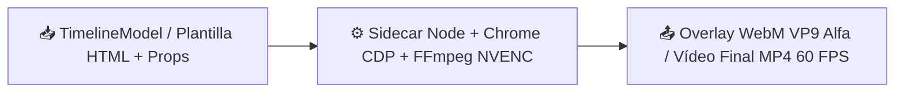

# 🧩 Sidecar de Renderizado y Motor FFmpeg

> [!abstract] En pocas palabras
> Es la fábrica visual de **VidForge Studio**: combina un proceso auxiliar en **Node.js + Chrome Headless** (que dibuja tarjetas animadas HTML/SVG con fondo transparente y efectos 3D [[Glosario#WebGL|WebGL]]) con un pipeline **FFmpeg** acelerado por tarjeta gráfica **[[Glosario#NVENC|NVIDIA NVENC]]** para entregar vídeos MP4 a 60 FPS sin tirones ni desfases de audio.

## 📥 Recibe → ⚙️ Hace → 📤 Entrega



| | Descripción | Ejemplo real en este proyecto |
|---|---|---|
| 📥 **Entrada** | Solicitud `vidforge.render/1` (`request.json`) o `TimelineModel` completo con pistas de vídeo, motion, subtítulos y audio | Plantilla `stat-highlight` con `{"value": "87%", "label": "Crecimiento anual"}` por `4.000.000 us` |
| 📤 **Salida** | Clip `.webm` con canal alfa (`yuva420p`, `alpha_mode=1`) o vídeo maestro `.mp4` codificado con `h264_nvenc` | `renders/render_9f2a1b4c.mp4` (`1920x1080`, `60 FPS`, subtítulos [[Glosario#ASS\|ASS]] incrustados) |

## 💡 Ejemplo paso a paso

> [!example] Renderizado de una escena animada con transparencia y composición final
> 1. `services/render.py` crea una carpeta temporal `storage/temp/sc_a1b2c3d4/` y escribe `request.json` indicando `"format": "webm_vp9_alpha"`.
> 2. Lanza `node.exe sidecar.mjs --request request.json` de forma oculta (`CREATE_NO_WINDOW`).
> 3. `sidecar.mjs` abre Chrome Headless con `puppeteer-core`, activa el fondo transparente vía [[Glosario#CDP|CDP]] (`Emulation.setDefaultBackgroundColorOverride` con `a: 0`) y carga `packages/templates/stat-highlight/index.html`.
> 4. Por cada fotograma ($t = 0\dots 119$), llama a `window.__vf.seek(tMs)`, toma la captura PNG en memoria y la envía por `stdin` (`image2pipe`) a FFmpeg para generar el archivo `.webm` con canal alfa.
> 5. Finalmente, `render_timeline_to_mp4` aplica el efecto [[Glosario#Ken Burns|Ken Burns]] sobreescalado `1.5x` a las imágenes base, las une con `xfade`, superpone el `.webm` transparente (`overlay`), quema los subtítulos `.ass` y codifica con `h264_nvenc`.
> **Resultado:** Un vídeo MP4 a 60 FPS donde la tarjeta animada flota suavemente sobre la escena sin bordes negros y sincronizada al milisegundo con el locutor.

## 🔌 Depende de / lo usan

- **Depende de:** `runtime/ffmpeg/ffmpeg.exe`, Chrome Headless / Edge (`get_chrome_path()`), `puppeteer-core`, `infra/hw.py` y `infra/procs.py` ([[Glosario#Job Object|Job Objects]]).
- **Lo usan:** [[Flujo de renderizado y escenas animadas]], [[Flujo de exportación a CapCut y OTIO]] y [[Catálogo de plantillas y contratos JSON]].

> [!info]- Detalle técnico
> - **Fórmula de compensación de transiciones (`compute_xfade_schedule` en `services/render.py`):**
>   Cuando FFmpeg aplica `xfade` de duración $t_k$ entre dos clips, la duración combinada se reduce en $t_k$. Para evitar que el vídeo termine antes que la locución, VidForge extiende cada clip $i < n-1$ sumándole la duración de la transición siguiente:
> ```python
> clip_d: list[int] = []
> for i in range(n):
>     ext = clamped_t[i] if i < n - 1 else 0
>     clip_d.append(int(slot_durations_us[i]) + ext)
> total_us = sum(clip_d) - sum(clamped_t)  # Exactamente igual a sum(slot_durations_us)
> ```
> - **Eliminación de *jitter* en Ken Burns:** antes de ejecutar `zoompan`, cada imagen se escala a `1.5x` (`2880x1620` para un lienzo 1080p) con `scale=pre_w:pre_h,crop=pre_w:pre_h`, evitando los saltos por redondeo de píxeles enteros en FFmpeg.
> - **Shaders [[Glosario#WebGL|WebGL]] incluidos en `sidecar.mjs`:** `crosswarp`, `directionalwarp`, `swirl` y `ripple`.

## ⚠️ Cuidado al modificar

- **Toda plantilla HTML/SVG nueva debe implementar el contrato `window.__vf`:** debe exponer `window.__vf = { init(props, canvas), seek(tMs) }` y animarse únicamente en función de `tMs` (nunca con `setInterval` ni animaciones CSS libres), o las capturas cuadro a cuadro saldrán congeladas.
- **Usa siempre `hiddenSpawn` / `spawn_hidden`:** nunca lances `ffmpeg` o `node` con `subprocess.Popen` estándar sin `CREATE_NO_WINDOW`, ya que abriría consolas emergentes frente al usuario.

## 🔗 Relacionado

- [[Arquitectura general]] · [[Flujo de renderizado y escenas animadas]] · [[Catálogo de plantillas y contratos JSON]] · [[Runbook · Fallo en Sidecar o FFmpeg NVENC]]
