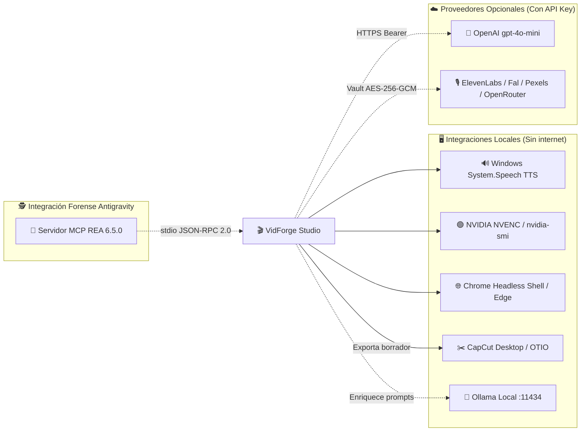

# 🔌 Integraciones

> [!abstract] En pocas palabras
> **VidForge Studio** funciona al 100 % sin internet usando las herramientas incluidas en tu computador (sintetizador de voz de Windows, FFmpeg, Chrome Headless y GPU NVIDIA), pero también puede conectarse opcionalmente con inteligencias artificiales locales (**Ollama**) o en la nube (**OpenAI, ElevenLabs, Pexels, Fal, OpenRouter**) y con **[[Glosario#CapCut Desktop|CapCut Desktop]]**.

## 🗺️ Mapa de integraciones locales y externas

## 🖥️ 1. Integraciones locales del sistema (por defecto)

Estas integraciones no requieren configurar ninguna clave ni tener conexión a internet:

| Sistema integrado | Cómo se conecta | Para qué lo usa VidForge | Qué pasa si no está disponible |
|---|---|---|---|
| **FFmpeg / FFprobe** (`runtime/ffmpeg/`) | Subproceso oculto (`CREATE_NO_WINDOW`) y tubería `image2pipe` | Codificar vídeo MP4/WebM, aplicar [[Glosario#Ken Burns\|Ken Burns]], mezclar transiciones [[Glosario#xfade\|xfade]] y procesar [[Glosario#AudioLab\|AudioLab]] | Busca `ffmpeg` en el `PATH` del sistema (`infra/paths.py`) |
| **NVIDIA GPU (`nvidia-smi` + `h264_nvenc`)** | Prueba en vivo de codificación `lavfi` al arrancar (`infra/hw.py`) | Acelerar por hardware la compresión de vídeo H.264 a 60 FPS | Cae automáticamente a `h264_amf`, `h264_qsv` o CPU (`libx264`) |
| **Chrome Headless / Microsoft Edge** | `puppeteer-core` vía [[Glosario#CDP\|CDP]] en `sidecar.mjs` | Dibujar plantillas animadas HTML/CSS/SVG y shaders [[Glosario#WebGL\|WebGL]] cuadro por cuadro | Busca `chrome-headless-shell.exe`, luego Google Chrome y por último Microsoft Edge (`msedge.exe`) |
| **Windows `System.Speech`** | Invocación PowerShell a `SpeechSynthesizer` (`services/audio.py`) | Generar locución [[Glosario#TTS\|TTS]] en español a archivo `.wav` sin internet | Activa el generador acústico determinista a 24 kHz PCM-16 |
| **[[Glosario#CapCut Desktop\|CapCut Desktop]]** | Escritura de `draft_content.json`, `draft_meta_info.json` y carpeta `Resources/` | Entregar el proyecto armado con pistas de vídeo, audio, textos y transiciones listas para editar | Verifica con `psutil` si `CapCut.exe` está abierto para evitar corrupción |
| **Windows Credential Manager + [[Glosario#DPAPI\|DPAPI]]** | Librería `keyring` y `win32crypt.CryptProtectData` | Cifrar la llave maestra de `secrets.v1.bin` vinculada al usuario de Windows | Usa llave local AES-256 en `storage/userdata/secrets.v1.key` |

## ☁️ 2. Proveedores de IA opcionales (Local LLM y Cloud)

En la pestaña **Hardware & Claves** (o mediante `/api/v1/providers/{provider}/secret`), el usuario puede registrar credenciales para enriquecer los prompts visuales o ampliar capacidades:

| Proveedor (`provider`) | Tipo | URL / Variable de entorno | Uso en el sistema |
|---|---|---|---|
| **`ollama`** | Local LLM | `http://127.0.0.1:11434/api/generate` (modelo por defecto `qwen2.5:3b`) | Enriquecer descripciones visuales de cada [[Glosario#Beat\|beat]] en `director.py` sin salir de tu red local |
| **`openai`** | Cloud LLM | `https://api.openai.com/v1/chat/completions` (`VIDFORGE_OPENAI_API_KEY`) | Generar prompts cinematográficos con `gpt-4o-mini` cuando `use_llm=true` |
| **`elevenlabs`** | Cloud TTS | `VIDFORGE_ELEVENLABS_API_KEY` | Reservado en bóveda para síntesis de voz cloud |
| **`pexels`** | Stock Media | `VIDFORGE_PEXELS_API_KEY` | Reservado en bóveda para búsqueda de clips de archivo |
| **`fal`** | Cloud Media | `VIDFORGE_FAL_API_KEY` | Reservado en bóveda para generación visual cloud |
| **`openrouter`** | Cloud LLM | `VIDFORGE_OPENROUTER_API_KEY` | Reservado en bóveda para ruteo multimodelo |

> [!example] Ejemplo de cadena de respaldo (*Fallback*) en el Director
> Cuando el usuario marca **Enriquecer con LLM** al segmentar su guion (`POST /api/v1/projects/{id}/script/segment`), `director.py` intenta primero consultar **OpenAI** (si existe clave en la bóveda); si no está configurada o falla, consulta **Ollama** en `http://127.0.0.1:11434` con timeout de 6 segundos; y si Ollama está apagado, conserva el prompt visual estructurado generado localmente sin detener ni fallar la operación.

## 🔬 3. Integración de REA con Google Antigravity

El entorno de ingeniería inversa se integra con el IDE **Google Antigravity** a través del protocolo **[[Glosario#MCP|MCP]]**:

- **Archivo de registro global:** `C:\Users\sebas\.gemini\config\mcp_config.json`
- **Comando de transporte `stdio`:** `cmd.exe /d /c npx -y rea-agents@6.5.0 mcp`
- **Motores integrados activos:** análisis estático de JavaScript/Electron, `rea-dotnet-static` (PE/CLI), `rea-pe-resources`, `rea-artifact-graph`, `go-build-info` y `rust-auditable`.

> [!info]- Detalle técnico de seguridad en credenciales
> Ninguna clave de API se guarda jamás en texto plano ni en `project.json` ni en `vidforge.db`. El endpoint `GET /api/v1/providers` devuelve únicamente si el proveedor está configurado (`configured: true/false`) y los últimos 4 caracteres (`last4: "****"`). En la bóveda en disco (`storage/userdata/secrets.v1.bin`), los valores se cifran con `AESGCM` de 256 bits y datos autenticados adicionales (`AAD = b"vidforge.secrets.v1"`).

## 🔗 Relacionado

- [[Arquitectura general]] · [[Servidor Backend y Gestor de Trabajos]] · [[Especialista REA y Auditoría Forense]] · [[Referencia API]]
