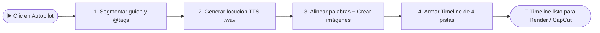

# 🔄 Flujo de Autopilot en un clic

> [!abstract] En pocas palabras
> Cuando el creador pulsa **Autopilot 1-Click**, **VidForge Studio** ejecuta automáticamente las 4 etapas de preproducción y montaje: divide el guion en escenas, graba la locución [[Glosario#TTS|TTS]], alinea cada palabra con el audio y construye la línea de tiempo con imágenes, subtítulos karaoke y gráficas animadas.

| ▶️ Empieza cuando | 🏁 Termina cuando | ⏱️ Duración típica | 🔁 Frecuencia |
|---|---|---|---|
| El usuario pulsa **Autopilot 1-Click** (`POST /api/v1/projects/{id}/autopilot`) | Se guarda `timeline.json` con las 4 pistas sincronizadas y se emite `job.succeeded` | 4 a 15 segundos (según longitud del guion) | Cada vez que se crea o regenera un proyecto |

## 🗺️ Vista general



## 🧭 Paso a paso

| # | Quién / qué | Hace | Resultado |
|---|---|---|---|
| **1** | `director.py` (`10 %`) | Lee `script.json`, extrae personajes `@Nombre` y divide el texto por oraciones en [[Glosario#Beat\|beats]], detectando si hay cifras o comparaciones | `script.json` actualizado con `characters` y `beats` |
| **2** | `audio.py` (`30 %`) | Sintetiza el texto completo en español con `System.Speech` (o generador acústico local) y mide su duración exacta con `ffprobe` | Archivo `Locución Maestra.wav` en `assets/audio/` y `narration_asset_id` asignado |
| **3** | `asr.py` + `media_gen.py` (`55 %`) | Ejecuta la [[Glosario#Alineación forzada\|alineación forzada]] palabra por palabra sobre el audio y genera una imagen PNG `1920x1080` con miniatura para cada escena | `TranscriptModel` en `vidforge.db` + imágenes `scene_01.png…` en `assets/images/` |
| **4** | `planner.py` (`85 % → 100 %`) | Construye la línea de tiempo multipista sin huecos, alternando efectos [[Glosario#Ken Burns\|Ken Burns]], transiciones [[Glosario#xfade\|xfade]], subtítulos [[Glosario#ASS\|ASS]] e insertando plantillas animadas donde hay datos numéricos | `timeline.json` guardado y evento `job.succeeded` en pantalla |

## 💡 Ejemplo real

> [!example] Proyecto de demostración con 3 escenas y dato estadístico (`87%`)
> - **Guion de entrada:** *"En el último año el rendimiento creció un 87% gracias a la automatización local. @Elena explica cómo el flujo tradicional versus el nuevo motor reduce los tiempos a la mitad. Finalmente logramos calidad de estudio a 60 cuadros por segundo."*
> - **Paso 1:** Se detecta el personaje `@Elena` (`CharacterModel(tag="@Elena", name="Elena")`) y se crean 3 beats (`beat_001`, `beat_002`, `beat_003`). Los dos primeros se marcan con `media_kind = "motion"` por contener `"87%"` y `"versus"`.
> - **Paso 2:** Se genera `narration_a1b2c3.wav` con una duración medida de `14.200.000 us` (`14,2 s`).
> - **Paso 3:** Se alinean las 39 palabras y se crean 3 imágenes `1920x1080` (`scene_01`, `scene_02`, `scene_03`) junto con sus miniaturas `.jpg` en `.cache/thumbs/`.
> - **Paso 4:** `build_auto_timeline` crea `track_video` (3 clips con Ken Burns y transiciones `fade`/`wipeleft`), `track_motion` (con la plantilla `stat-highlight` mostrando `"87%"` en el primer segmento), `track_subs` (subtítulos karaoke) y `track_audio`.

## 🛠️ ¿Y si algo sale mal?

| Situación | Qué ve el usuario | Qué hace el sistema | Qué hacer |
|---|---|---|---|
| El motor TTS de Windows no tiene voz instalada | El trabajo no falla; continúa normalmente | `synthesize_tts` cambia automáticamente al generador acústico PCM-16 a 24 kHz | Opcional: instalar paquete de voz Español en Configuración de Windows o subir locución propia en **Multimedia & AudioLab** |
| El guion está vacío | Se procesa con texto de respaldo `"Texto de prueba."` | Genera un beat único para no romper el flujo | Escribir el guion en **Director & Prompts** y volver a pulsar Autopilot |

> [!info]- Detalle técnico (secuencia)
> ```mermaid
> sequenceDiagram
>     autonumber
>     actor U as Creador (SPA React)
>     participant API as FastAPI (/autopilot)
>     participant JM as JobManager (pool: cpu)
>     participant SRV as Servicios (Director/Audio/ASR/Planner)
>     participant DB as SQLite WAL + .vfproj
>     U->>API: POST /api/v1/projects/{id}/autopilot
>     API->>JM: submit("autoplan", _runner)
>     JM-->>U: 200 OK (job_id, state: "queued")
>     JM->>SRV: Ejecuta _runner con report()
>     SRV->>DB: 1/4 Guarda script.json segmentado
>     SRV->>DB: 2/4 Guarda Locución Maestra.wav
>     SRV->>DB: 3/4 Guarda TranscriptModel + Imágenes
>     SRV->>DB: 4/4 Guarda timeline.json sincronizado
>     JM-->>U: SSE event "job.succeeded"
> ```

## 🔗 Relacionado

- [[Servidor Backend y Gestor de Trabajos]] · [[Alineador ASR y Planificador de Timeline]] · [[Flujo de renderizado y escenas animadas]] · [[Flujo de exportación a CapCut y OTIO]]
