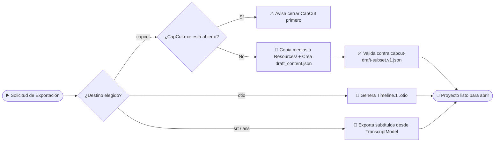

# 🔄 Flujo de exportación a CapCut y OTIO

> [!abstract] En pocas palabras
> Permite llevar tu proyecto de **VidForge Studio** a tu programa de edición favorito sin perder nada: crea una carpeta de proyecto nativa para **[[Glosario#CapCut Desktop|CapCut Desktop]]** (con sus pistas, medios copiados, subtítulos y transiciones ya puestos), un archivo universal **[[Glosario#OTIO|OpenTimelineIO (`.otio`)]]** o los archivos de subtítulos **`.srt` / `.ass`**.

| ▶️ Empieza cuando | 🏁 Termina cuando | ⏱️ Duración típica | 🔁 Frecuencia |
|---|---|---|---|
| El usuario elige exportar (`POST /api/v1/projects/{id}/exports`) indicando `capcut`, `otio`, `srt` o `ass` | Se escriben y validan los archivos en `exports/` (o en la carpeta de borradores de CapCut) | Menos de 1 segundo | Al terminar un proyecto para postproducción |

## 🗺️ Vista general

## 🧭 Paso a paso (Exportación a CapCut Desktop)

| # | Quién / qué | Hace | Resultado |
|---|---|---|---|
| **1** | `export.py` (`is_capcut_running`) | Cuando se exporta hacia una carpeta activa de CapCut con `check_process_lock=True`, revisa con `psutil` que `CapCut.exe` no esté en ejecución | Evita que CapCut sobrescriba el índice de borradores en memoria |
| **2** | `export.py` (`Resources/`) | Crea la carpeta `<draft_root>/<Nombre>_CapCut/Resources/` y copia (`shutil.copy2`) cada imagen, vídeo, overlay `.webm` y locución `.wav` usados en las pistas | Carpeta autocontenida que no se rompe si mueves los archivos originales |
| **3** | `export.py` (`materials` y `tracks`) | Traduce cada pista de `TimelineModel` (`video`, `audio`, `subtitle`) a los catálogos `materials.videos`, `materials.audios`, `materials.texts` y `materials.transitions` de CapCut | Estructura `draft_content.json` y `draft_meta_info.json` con tiempos en microsegundos |
| **4** | `export.py` (`validate_capcut_draft`) | Valida el JSON generado contra el esquema `capcut-draft-subset.v1.json` y verifica integridad referencial (`material_id` existentes y cero solapes por pista) | Si hubiera un solo error estructural, aborta antes de entregar un borrador corrupto |

## 💡 Ejemplo real

> [!example] Exportación del proyecto `"Lanzamiento Q4"` a CapCut Desktop
> - **Petición:** `POST /api/v1/projects/8f4e.../exports` con `{"target": "capcut", "draft_name": "Lanzamiento_Q4_CapCut", "copy_media": true}`.
> - **Archivos creados en `exports/Lanzamiento_Q4_CapCut/`:**
>   - `draft_content.json`: lienzo `1920x1080` (`ratio: "16:9"`, `fps: 60.0`), 3 materiales en `videos`, 1 en `audios`, 2 en `transitions` y 3 en `texts`.
>   - `draft_meta_info.json`: metadatos `draft_fold_path`, `draft_name` y marcas de tiempo en microsegundos (`tm_draft_create`).
>   - `Resources/`: copias locales `vclip_001_scene_01.png`, `aclip_narration_tts.wav`, etc.
> - **Validación:** `validation_errors: []` (0 errores). El usuario abre CapCut Desktop y encuentra las pistas listas para editar.

## 🛠️ ¿Y si algo sale mal?

| Situación | Qué ve el usuario | Qué hace el sistema | Qué hacer |
|---|---|---|---|
| `CapCut.exe` está abierto al exportar con bloqueo activo | Mensaje `"CapCut está abierto. Ciérralo antes de exportar..."` | Cancela la escritura para proteger los borradores existentes | Cerrar CapCut Desktop y volver a pulsar Exportar |
| Se pide exportar `.srt` o `.ass` sin haber alineado el audio | Error `400: No active transcript to export` | Informa que falta la transcripción | Ejecutar primero **Alinear Palabras** en la pestaña **Sync & Plantillas** o usar **Autopilot 1-Click** |

> [!info]- Detalle técnico (invariantes verificados en `validate_capcut_draft`)
> Además de validar el esquema JSON (`packages/contracts/capcut-draft-subset.v1.json`), `validate_capcut_draft` comprueba por código tres invariantes matemáticos que CapCut exige para no mostrar "Proyecto dañado":
> 1. **Integridad referencial:** todo `segment.material_id` y cada elemento de `extra_material_refs` debe existir dentro de `materials.{videos,audios,texts,transitions,animations}`.
> 2. **No solape dentro de una misma pista:** para cada segmento consecutivo de un track, `target_timerange.start >= last_end`.
> 3. **Cota superior de duración:** ningún segmento puede terminar después de `draft.duration` (`s_us + d_us <= total_dur`).

## 🔗 Relacionado

- [[Alineador ASR y Planificador de Timeline]] · [[Catálogo de plantillas y contratos JSON]] · [[Cómo crear y exportar un vídeo con IA]]
