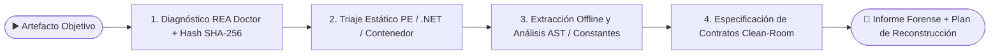

# 🔄 Flujo de ingeniería inversa con REA

> [!abstract] En pocas palabras
> Es el procedimiento forense estandarizado en este workspace para inspeccionar cualquier programa empaquetado en Windows (instaladores, ejecutables `.exe`/`.pyd`, ensamblados `.NET` o bundles JavaScript) en modo 100 % pasivo (sin ejecutarlo) usando **[[Glosario#REA|REA]] (`rea-agents@6.5.0`)** y convertir los hallazgos en especificaciones *[[Glosario#Clean-Room|Clean-Room]]*.

| ▶️ Empieza cuando | 🏁 Termina cuando | ⏱️ Duración típica | 🔁 Frecuencia |
|---|---|---|---|
| Se deposita un artefacto objetivo en `d:\rea-projects\projects\<nombre>\` | Se entregan los informes con hashes SHA-256, evidencias MCP (`ev_...`) y contratos de reconstrucción | 15 a 45 minutos por paquete completo | Por cada auditoría o comparación de versiones |

## 🗺️ Vista general



## 🧭 Paso a paso

| # | Quién / qué | Hace | Resultado |
|---|---|---|---|
| **1** | **Verificación de Salud y Digests** | Ejecuta `npx.cmd rea-agents@6.5.0 doctor --client antigravity --json` y calcula los hashes SHA-256 de todos los archivos recibidos sin ejecutarlos | Inventario criptográfico base y confirmación `healthy: true` |
| **2** | **Triaje de Formato y Compilador** | Invoca las herramientas [[Glosario#MCP\|MCP]] de REA (`inspect_pe_resources`, `inspect_managed_artifact`, `inspect_go_binary`, `inspect_rust_binary`) para identificar la arquitectura real del binario | Clasificación empírica con ID de evidencia (`ev_...`), descartando suposiciones |
| **3** | **Desempaquetado y Análisis Profundo** | Si es un contenedor o instalador, extrae sus flujos en una carpeta aislada (`extracted_app/`) y analiza scripts JS/Electron con `analyze_javascript_application` o tablas de constantes en binarios [[Glosario#Nuitka\|Nuitka]] / `.NET` | Catálogo de rutas HTTP, esquemas de base de datos, llamadas IPC y dependencias |
| **4** | **Documentación y Especificación Clean-Room** | Registra cada hecho comprobado (`[OBSERVADO]`) separado de cualquier hipótesis y redacta los contratos JSON Schema para la reconstrucción limpia | Documentos `INFORME.md`, `ARQUITECTURA.md`, `DEPENDENCIAS.md`, `FUNCIONES.md` y `PLAN-EJECUCION-RECONSTRUCCION.md` |

## 💡 Ejemplo real

> [!example] Auditoría de `Creator-IA-2.0_a5` en `projects/01-generadorVideos`
> 1. **Fase 1 (Inventario):** Se verificó `Creator-IA-2.0_a5.rar` (`658.504.254 bytes`, SHA-256 `7B7A4B30...`) y sus piezas `Creator-IA-2.0_a5-Setup.exe` + `Setup-1.bin`.
> 2. **Fase 2 (Triaje con REA):**
>    - `inspect_pe_resources` sobre `Setup.exe` generó la evidencia `ev_c15e6515...`, revelando la tabla de offsets de [[Glosario#Inno Setup|Inno Setup]] en el recurso `RT_RCDATA` (`11111`).
>    - `inspect_managed_artifact`, `inspect_go_binary` e `inspect_rust_binary` sobre `Creator-IA.exe` (`ev_9752cdd5...`, `ev_3098ac9f...`, `ev_d8afed8f...`) confirmaron que no era ni `.NET`, ni Go, ni Rust, sino un *bootstrapper* nativo C/C++ MSVC x64.
> 3. **Fase 3 (Extracción y AST):** Se desempaquetaron los 207 artefactos verificando el 100 % de sus hashes contra `MANIFEST-2.0.json`, se analizaron `27.038` nodos AST del frontend con `analyze_javascript_application` (`ev_d6f1bb55...`) y se recuperaron las 193 rutas HTTP de los 15 binarios `.pyd`.
> 4. **Fase 4 (Clean-Room):** Con esa especificación se construyó **VidForge Studio** en `d:\rea-projects\vidforge`.

## 🛠️ ¿Y si algo sale mal?

| Situación | Qué ve el usuario | Qué hace el sistema | Qué hacer |
|---|---|---|---|
| PowerShell bloquea `npx` con error de `ExecutionPolicy` | `No se puede cargar el archivo ... npx.ps1` | Windows impide ejecutar scripts `.ps1` sin firmar | Usar siempre `npx.cmd` o `npm.cmd` → ver [[Cómo auditar binarios con REA en Windows]] |
| Las herramientas `rea/*` no aparecen en la sesión de Antigravity | El agente no ve las herramientas MCP | El cliente Antigravity aún no recargó `mcp_config.json` | Seguir [[Runbook · Herramientas MCP de REA no disponibles]] |

> [!info]- Detalle técnico (ruteo de herramientas REA según el artefacto)
> ```mermaid
> flowchart TD
>     art[Artefacto a investigar] --> tipo{¿Qué tipo de archivo es?}
>     tipo -->|JS / Electron / .asar| js[analyze_javascript_application + inspect_electron_fuses]
>     tipo -->|Ensamblado .NET PE/CLI| net[inspect_managed_artifact + inspect_managed_members]
>     tipo -->|Ejecutable Nativo PE x86/x64| pe[inspect_pe_resources + inspect_go/rust_binary + Ghidra opcional]
>     tipo -->|Contenedor ZIP / MSIX / AppX| zip[open_binary + inspect_artifact]
> ```

## 🔗 Relacionado

- [[Especialista REA y Auditoría Forense]] · [[Cómo auditar binarios con REA en Windows]] · [[ADR-001 Reconstrucción Clean-Room con FastAPI y Sidecar ESM]] · [[Runbook · Herramientas MCP de REA no disponibles]]
