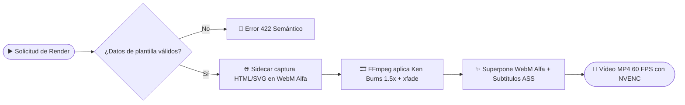

# 🔄 Flujo de renderizado y escenas animadas

> [!abstract] En pocas palabras
> Convierte la línea de tiempo del proyecto en un archivo de vídeo **MP4 a 60 FPS** listo para publicar: primero comprueba que los datos de las tarjetas animadas coincidan con lo que dice el locutor, las dibuja en un navegador oculto con fondo transparente, anima cada escena con efecto [[Glosario#Ken Burns|Ken Burns]], encadena las transiciones y quema los subtítulos karaoke usando aceleración [[Glosario#NVENC|NVIDIA NVENC]].

| ▶️ Empieza cuando | 🏁 Termina cuando | ⏱️ Duración típica | 🔁 Frecuencia |
|---|---|---|---|
| El usuario pulsa **Renderizar MP4** (`POST /api/v1/projects/{id}/renders`) o renderiza una plantilla (`POST /motion-scenes/render`) | Se genera `renders/render_<id>.mp4` y aparece listo para descargar o abrir en el Explorador | 5 a 25 segundos para un proyecto estándar | Cada vez que se produce el vídeo final |

## 🗺️ Vista general



## 🧭 Paso a paso

| # | Quién / qué | Hace | Resultado |
|---|---|---|---|
| **1** | `planner.py` (`validate_motion_semantics`) | Verifica que las cifras o textos de las plantillas animadas aparezcan realmente en la locución | Si hay discrepancia, detiene el proceso con `422 Unprocessable Entity` |
| **2** | `sidecar.mjs` + Chrome Headless | Abre cada plantilla HTML/CSS/SVG de `track_motion`, avanza el reloj cuadro a cuadro (`window.__vf.seek`) y envía capturas PNG transparentes por tubería a FFmpeg | Clips `.webm` (`libvpx-vp9`, `yuva420p`, `alpha_mode=1`) en `assets/motion/` |
| **3** | `render.py` (`_prepare_single_clip_segment`) | Prepara cada clip visual de `track_video`: sobreescala las imágenes `1.5x` y aplica `zoompan` ([[Glosario#Ken Burns\|Ken Burns]]) extendiendo la duración según `compute_xfade_schedule` | Segmentos intermedios `.mp4` a 60 FPS sin temblor (*jitter*) |
| **4** | `render.py` (encadenado `xfade` / [[Glosario#WebGL\|WebGL]]) | Une los segmentos aplicando filtros `xfade` o el shader GLSL correspondiente (`crosswarp`, `directionalwarp`, `swirl`, `ripple`) | Pista visual continua de duración exacta $\sum s_i$ |
| **5** | `render.py` (composición final) | Superpone los `.webm` transparentes (`overlay`), quema los subtítulos [[Glosario#ASS\|ASS]] (`subtitles=...`) y mezcla la pista de audio AAC a `192 kbps` | Archivo final `renders/render_<id>.mp4` registrado en `vidforge.db` |

## 💡 Ejemplo real

> [!example] Renderizado de un proyecto 1080p a 60 FPS con tarjeta `stat-highlight`
> 1. La pista de vídeo tiene 2 escenas de `3,0 s` cada una (`3_000_000 us`), unidas por una transición `fade` de `0,5 s` (`500_000 us`).
> 2. `compute_xfade_schedule` calcula que el Clip 1 debe durar `3,5 s` (`3_500_000 us`) y el Clip 2 `3,0 s`, con `offset = 3,0 s`. Así, tras el solape de `0,5 s`, el vídeo resultante mide exactamente `6,0 s` (`3,5 + 3,0 - 0,5 = 6,0 s`), coincidiendo al milisegundo con la locución.
> 3. El [[Glosario#Sidecar|Sidecar]] renderiza la tarjeta `stat-highlight` (`87%`) como WebM VP9 transparente entre `0,1 s` y `4,1 s`.
> 4. FFmpeg codifica el resultado final con `-c:v h264_nvenc -preset p4 -cq 20` y reporta el avance en vivo leyendo `out_time_us=` desde la tubería de progreso.

## 🛠️ ¿Y si algo sale mal?

| Situación | Qué ve el usuario | Qué hace el sistema | Qué hacer |
|---|---|---|---|
| La cifra de una tarjeta animada no está en el guion | Mensaje `422: La cifra '99%' en 'value' no aparece en el texto hablado` | Bloquea el render antes de gastar GPU (*Fail-Closed*) | Corregir el valor de la propiedad para que coincida con el guion |
| El equipo no tiene tarjeta gráfica NVIDIA | El render funciona igual, ligeramente más lento | `detect_hardware()` selecciona automáticamente `libx264` en CPU | Ninguna acción necesaria; ver [[Runbook · Fallo en Sidecar o FFmpeg NVENC]] si falla FFmpeg |

> [!info]- Detalle técnico (secuencia Sidecar ↔ FFmpeg)
> ```mermaid
> sequenceDiagram
>     autonumber
>     participant PY as Backend Python (render.py)
>     participant ND as Sidecar Node.js (sidecar.mjs)
>     participant CH as Chrome Headless (CDP)
>     participant FF as FFmpeg (image2pipe)
>     PY->>ND: spawn_hidden(node sidecar.mjs --request req.json)
>     ND-->>PY: JSONL {"type": "ready", "protocol": "vidforge.render/1"}
>     ND->>CH: Abre template/index.html + fondo alfa=0
>     ND->>FF: Abre stdin pipe (-f image2pipe -vcodec png)
>     loop Por cada fotograma (0..totalFrames-1)
>         ND->>CH: window.__vf.seek(tMs) + page.screenshot(omitBackground: true)
>         CH-->>ND: Buffer PNG en memoria
>         ND->>FF: stdin.write(buf)
>         ND-->>PY: JSONL {"type": "progress", "frame": i, "total": N}
>     end
>     ND->>FF: stdin.end()
>     FF-->>ND: Sale con código 0 (WebM VP9 con alpha_mode=1)
> ```

## 🔗 Relacionado

- [[Sidecar de Renderizado y Motor FFmpeg]] · [[Catálogo de plantillas y contratos JSON]] · [[Runbook · Fallo en Sidecar o FFmpeg NVENC]]
