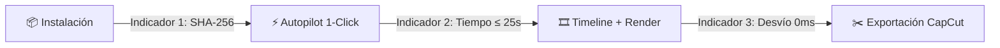

# 📊 Indicadores y métricas

> [!abstract] En pocas palabras
> Números concretos que responden si **VidForge Studio** y el entorno **[[Glosario#REA|REA]]** están funcionando como deben: qué tan rápido se genera un vídeo, qué tan exacta es la sincronización de subtítulos y si algún archivo del sistema fue alterado.

## 📋 Tablero resumen de indicadores

| Indicador | 🎯 Meta | 📏 Unidad | 🔁 Frecuencia | 👤 Dueño | 🟢🟡🔴 Semáforo |
|---|---|---|---|---|---|
| **1. Integridad de instalación (`MANIFEST.json`)** | `100 %` | `%` de archivos | En cada arranque / build | SebzSGC | 🟢 `100 %` · 🔴 `< 100 %` |
| **2. Tiempo de armado Autopilot 1-Click** | `≤ 25 s` | segundos | Por proyecto | SebzSGC | 🟢 `≤ 15 s` · 🟡 `16–25 s` · 🔴 `> 25 s` |
| **3. Exactitud temporal del Timeline (`xfade`)** | `0 ms` de desvío | milisegundos | Por render | SebzSGC | 🟢 `0 ms` · 🟡 `1–20 ms` · 🔴 `> 20 ms` |
| **4. Salud del servidor MCP de REA** | `207 / 207` | herramientas | Al auditar con `doctor` | SebzSGC | 🟢 `207` · 🟡 `parcial` · 🔴 `0` |

## 🗺️ Cómo se miden a lo largo del flujo



---

## 1. Integridad criptográfica de la instalación (`MANIFEST.json`)

- **¿Qué responde?** ¿Todos los archivos del backend, la interfaz web compilada, el sidecar y las plantillas están intactos y sin corrupción?
- **Cómo se calcula (en llano):**
  > $$\text{Archivos que coinciden con su huella SHA-256} \div \text{Total de archivos registrados en MANIFEST.json} \times 100$$

> [!example] Medición real en `d:\rea-projects\vidforge` (Octubre 2026)
> - Archivos auditados en `MANIFEST.json`: **78**
> - Archivos con hash SHA-256 idéntico: **78**
> - Cálculo: $78 \div 78 \times 100 = \mathbf{100\,\%}$ → 🟢 (`OK: Verified 78 files and backend imports.`)

> [!info]- Fórmula técnica (`tools/verify-install.py`)
> ```python
> actual = hashlib.sha256(fp.read_bytes()).hexdigest()
> if actual != expected_hash:
>     sys.stderr.write(f"Hash mismatch for {rel}\n")
>     return 3
> ```
> Origen: `d:\rea-projects\vidforge\MANIFEST.json` (`schema: "vidforge.manifest/1"`).

---

## 2. Exactitud temporal de encadenado `xfade`

- **¿Qué responde?** Cuando se unen varias escenas con transiciones suaves, ¿el vídeo final dura exactamente lo mismo que la locución de voz o se va atrasando?
- **Cómo se calcula (en llano):**
  > $$\text{Duración de todos los clips extendidos} - \text{Suma de las transiciones} - \text{Duración de la locución}$$

> [!example] Ejemplo numérico con 3 escenas y 2 transiciones
> - Escenas lógicas ($s_i$): `4,0 s` + `5,0 s` + `3,0 s` = **12,0 s** (`12.000.000 us`)
> - Transiciones ($t_k$): `0,5 s` + `0,5 s` = **1,0 s** (`1.000.000 us`)
> - Clips extendidos por VidForge ($d_i$): `4,5 s` + `5,5 s` + `3,0 s` = **13,0 s**
> - Duración final tras `xfade`: $13,0\text{ s} - 1,0\text{ s} = \mathbf{12,0\text{ s}}$ → Desvío = **0 ms** (🟢)

> [!info]- Fórmula técnica (`services/render.py` y pruebas `hypothesis`)
> ```python
> clip_d, offsets, total_us = compute_xfade_schedule(slot_durations_us, transition_durations_us)
> assert total_us == sum(slot_durations_us)
> ```
> Verificado con pruebas basadas en propiedades (`hypothesis`) en `apps/backend/tests/test_vidforge_suite.py`.

---

## 3. Cobertura forense y salud de REA en Windows

- **¿Qué responde?** ¿Qué porcentaje de los artefactos del paquete objetivo fue extraído y verificado sin errores y cuántas herramientas [[Glosario#MCP|MCP]] están operativas?
- **Cómo se calcula (en llano):**
  > $$\text{Artefactos extraídos con SHA-256 válido} \div \text{Artefactos listados en el manifiesto del instalador} \times 100$$

> [!example] Auditoría de `Creator-IA 2.0_a5`
> - Artefactos propios en `MANIFEST-2.0.json`: **207**
> - Artefactos extraídos y verificados bit a bit en `extracted_app/`: **207** (`100 %` 🟢)
> - Herramientas MCP activas en `rea-agents@6.5.0`: **207 herramientas** (`healthy: true` 🟢)

## ⚠️ Cuidado al interpretar

- El **tiempo de Autopilot 1-Click** se mide en modo local offline; si el usuario activa la opción `use_llm=true` contra una API externa en la nube (OpenAI) o un modelo pesado en Ollama, el tiempo dependerá de la latencia de red o de la velocidad de inferencia del modelo elegido.

## 🔗 Relacionado

- [[Resumen ejecutivo]] · [[Modelo de datos]] · [[Monitoreo y diagnóstico]]
