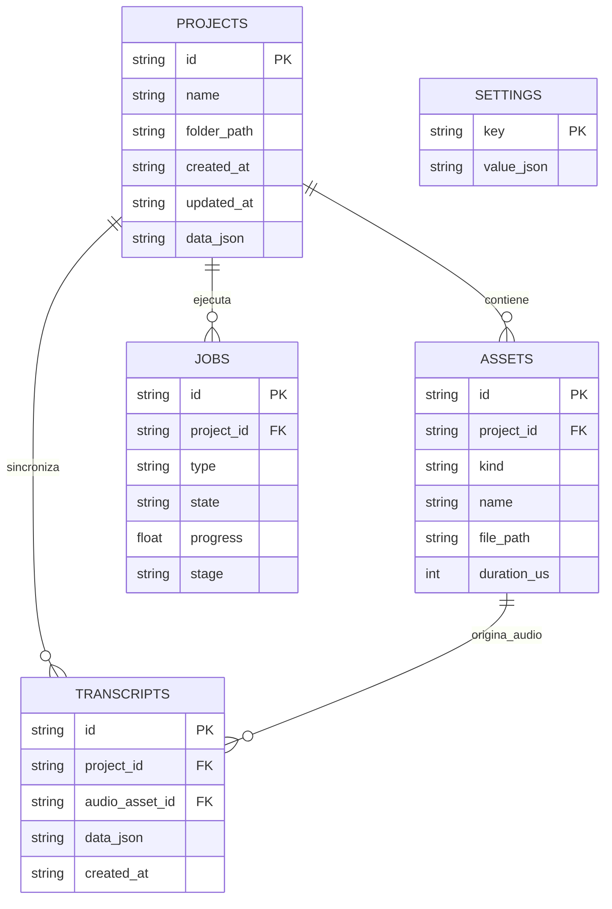
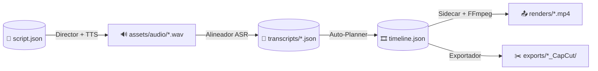

# 🗄️ Modelo de datos

> [!abstract] En pocas palabras
> **VidForge Studio** guarda la información en dos lugares que trabajan en equipo: un índice rápido en **[[Glosario#SQLite WAL|SQLite WAL]] (`vidforge.db`)** para buscar proyectos, archivos, transcripciones y tareas al instante, y una carpeta independiente **[[Glosario#vfproj|`.vfproj`]]** por cada proyecto para que puedas respaldarlo o moverlo como cualquier carpeta de Windows.

## 🗺️ Diagrama Entidad-Relación (`vidforge.db`)

> [!tip] Cómo leer el diagrama
> `||--o{` significa **"uno a muchos"**: **un** proyecto (`PROJECTS`) tiene **cero o muchos** archivos multimedia (`ASSETS`), transcripciones (`TRANSCRIPTS`) y trabajos en segundo plano (`JOBS`).

## 📋 Diccionario de datos (`storage/userdata/vidforge.db`)

### 1. Tabla `projects`
**Qué representa:** Cada proyecto audiovisual creado en el estudio · **Se actualiza:** Al crear proyecto, editar guion, alinear o cambiar la línea de tiempo.

| Campo | Tipo | Significado (en llano) | Ejemplo | ¿Obligatorio? |
|---|---|---|---|---|
| `id` | texto (UUID) | Identificador único del proyecto | `"8f4e2b10-9a3c-4d7e-b123-7c8e9d0a1b2c"` | ✅ |
| `name` | texto | Nombre visible del proyecto | `"Lanzamiento Q4"` | ✅ |
| `folder_path` | texto | Ruta absoluta de su carpeta `.vfproj` | `"D:/rea-projects/vidforge/storage/projects/Lanzamiento_Q4_8f4e2b10.vfproj"` | ✅ |
| `created_at` | texto ISO | Fecha y hora de creación (UTC) | `"2026-10-16T13:10:00+00:00"` | ✅ |
| `updated_at` | texto ISO | Última modificación (UTC) | `"2026-10-18T16:45:12+00:00"` | ✅ |
| `data_json` | JSON | Configuración de lienzo (`1920x1080`, `60 FPS`), idioma y activos maestros | `{"schema_version": "project/1", "language": "es", ...}` | ✅ |

### 2. Tabla `assets`
**Qué representa:** Archivos de imagen, vídeo, locución, escenas animadas `.webm` y renders finales `.mp4` asociados a un proyecto.

| Campo | Tipo | Significado (en llano) | Ejemplo | ¿Obligatorio? |
|---|---|---|---|---|
| `id` | texto (UUID) | Identificador único del activo | `"3a9f1c20-..."` | ✅ |
| `project_id` | texto (UUID) | Proyecto al que pertenece | `"8f4e2b10-..."` | ✅ |
| `kind` | texto | Tipo de medio (`image`, `video`, `audio`, `motion`, `render`) | `"motion"` | ✅ |
| `name` | texto | Nombre de archivo legible | `"motion_stat-highlight_3a9f1c.webm"` | ✅ |
| `file_path` | texto | Ruta en disco del archivo real | `"D:/.../assets/motion/motion_stat-highlight_3a9f1c.webm"` | ✅ |
| `duration_us` | entero | Duración en microsegundos (`1 s = 1.000.000 us`) | `4000000` | ✅ |

### 3. Tabla `transcripts`
**Qué representa:** El resultado de la [[Glosario#Alineación forzada|alineación forzada]] palabra por palabra entre la locución y el guion.

| Campo | Tipo | Significado (en llano) | Ejemplo | ¿Obligatorio? |
|---|---|---|---|---|
| `id` | texto | Identificador de la transcripción | `"tr_7d2b9e1a"` | ✅ |
| `project_id` | texto | Proyecto al que pertenece | `"8f4e2b10-..."` | ✅ |
| `audio_asset_id` | texto | Audio sobre el que se calculó la alineación | `"a1b2c3d4-..."` | ✅ |
| `data_json` | JSON | `TranscriptModel` con lista de `words` (`start_us`, `end_us`, `confidence`) y `segments` | `{"schema_version": "transcript/1", "words": [...]}` | ✅ |

### 4. Tabla `jobs` y tabla `settings`
- **`jobs`:** registra cada tarea asíncrona (`type`: `tts`, `image_gen`, `audio_process`, `asr`, `motion_render`, `render`, `autoplan`) con su estado (`queued`, `running`, `succeeded`, `failed`, `cancelled`) y porcentaje (`progress` de `0.0` a `1.0`).
- **`settings`:** guarda preferencias globales clave-valor (`whisper_model: "base"`, `default_fps: 60`, `ollama_url: "http://127.0.0.1:11434"`, `ollama_model: "qwen2.5:3b"`).

## 🔄 Origen, linaje y estructura en disco (`.vfproj`)

> [!example] Ejemplo real de estructura de una carpeta `.vfproj`
> Dentro de `d:\rea-projects\vidforge\storage\projects\Demo_8f4e2b10.vfproj\`:
> - `project.json` — metadatos del proyecto (`project/1`)
> - `script.json` — guion, personajes `@Tag` y [[Glosario#Beat|beats]] (`script/1`)
> - `timeline.json` — las 4 pistas, clips, efectos [[Glosario#Ken Burns|Ken Burns]] y transiciones (`timeline/1`)
> - `assets/images/`, `assets/videos/`, `assets/audio/`, `assets/motion/` — medios generados o subidos
> - `.cache/thumbs/` — miniaturas `.jpg` para carga instantánea en la interfaz
> - `renders/` — vídeos `.mp4` terminados
> - `exports/` — carpetas de [[Glosario#CapCut Desktop|CapCut Desktop]], archivos `.otio`, `.srt` y `.ass`

## 🔒 Datos sensibles y protección

| Dato sensible | Dónde vive | Cómo se protege |
|---|---|---|
| **Claves API de proveedores** (`openai`, `elevenlabs`, `pexels`, `fal`, `openrouter`, `ollama`) | `storage/userdata/secrets.v1.bin` + Windows Credential Manager | Cifrado autenticado **[[Glosario#AES-256-GCM\|AES-256-GCM]]** (`AAD = vidforge.secrets.v1`) cuya llave maestra (`secrets.v1.key`) se protege con **[[Glosario#DPAPI\|Windows DPAPI]]** (`CryptProtectData`). En la API solo se expone `<SECRETO: ver gestor de claves>` (`last4: "****"`). |

## 🔗 Relacionado

- [[Indicadores y métricas]] · [[Arquitectura general]] · [[Servidor Backend y Gestor de Trabajos]] · [[ADR-002 Almacenamiento híbrido SQLite WAL y carpetas vfproj]] · [[Catálogo de plantillas y contratos JSON]]
