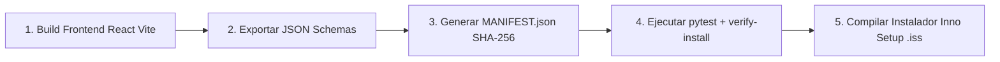

# 🚀 Despliegue e instalador

> [!abstract] En pocas palabras
> Explica cómo se actualiza, sella criptográficamente (`MANIFEST.json`) y empaqueta **VidForge Studio** en un instalador autocontenido de Windows (`VidForge-Studio-1.0.0-Setup.exe`) que no pide permisos de administrador.

## 🗺️ Flujo de compilación y empaquetado



## 🪜 Procedimiento paso a paso para generar una nueva entrega

### 1. Compilar la interfaz web (`apps/web/dist`)
Si realizaste cambios en `d:\rea-projects\vidforge\apps\web\src\`:

```powershell
# Compila la aplicación React 18 en la carpeta estática apps/web/dist
npm.cmd --prefix "d:\rea-projects\vidforge\apps\web" run build
```

### 2. Sincronizar los esquemas Pydantic y regenerar `MANIFEST.json`
Cada vez que cambie un archivo en `apps/backend/src`, `apps/web/dist`, `apps/render-sidecar/src` o `packages/`, actualiza el manifiesto SHA-256:

```powershell
# Exporta esquemas JSON desde Pydantic y recalcula los 78 hashes SHA-256 de MANIFEST.json
d:\rea-projects\vidforge\runtime\venv\Scripts\python.exe d:\rea-projects\vidforge\tools\export-schemas.py
d:\rea-projects\vidforge\runtime\venv\Scripts\python.exe d:\rea-projects\vidforge\tools\verify-install.py --generate d:\rea-projects\vidforge
```

> [!example] Salida esperada al sellar el manifiesto
> ```text
> Generated manifest for D:\rea-projects\vidforge
> OK: Verified 78 files and backend imports.
> ```

### 3. Aprovisionar binarios del runtime aislado (si se prepara desde cero)
El script `tools/fetch-runtimes.ps1` automatiza la descarga verificada de `FFmpeg` y `Chrome Headless Shell` dentro de `runtime/`:

```powershell
# Verifica o descarga los binarios aislados en d:\rea-projects\vidforge\runtime
powershell -ExecutionPolicy Bypass -File "d:\rea-projects\vidforge\tools\fetch-runtimes.ps1"
```

### 4. Compilar el instalador con [[Glosario#Inno Setup|Inno Setup 6]]
El archivo `d:\rea-projects\vidforge\installer\vidforge.iss` define el instalador para Windows x64:

| Parámetro en `vidforge.iss` | Valor configurado | Por qué está configurado así |
|---|---|---|
| `DefaultDirName` | `{localappdata}\Programs\VidForge` | Instala en la carpeta del usuario sin requerir cuenta de Administrador (`PrivilegesRequired=lowest`) |
| `Compression` | `lzma2/fast` con `SolidCompression=no` | Permite extraer y verificar archivos individuales rápidamente sin descomprimir todo el bloque |
| `AppMutex` | `Local\VidForge.Runtime.v1` | Impide que el instalador sobrescriba archivos si VidForge Studio está abierto |
| `[Run]` post-instalación | `verify-install.py "{app}"` | Comprueba automáticamente los 78 hashes SHA-256 antes de dar por terminada la instalación |

> [!info]- Detalle técnico (códigos de salida de `verify-install.py`)
> - `0`: Todos los archivos existen, sus hashes SHA-256 coinciden con `MANIFEST.json` y `vidforge.api.app` importa sin errores.
> - `2`: Falta al menos un archivo listado en `MANIFEST.json` (`Missing file`).
> - `3`: Al menos un archivo fue modificado o corrompido respecto al hash esperado (`Hash mismatch`).

## 🔗 Relacionado

- [[Operación]] · [[Monitoreo y diagnóstico]] · [[Indicadores y métricas]] · [[Primeros pasos]]
