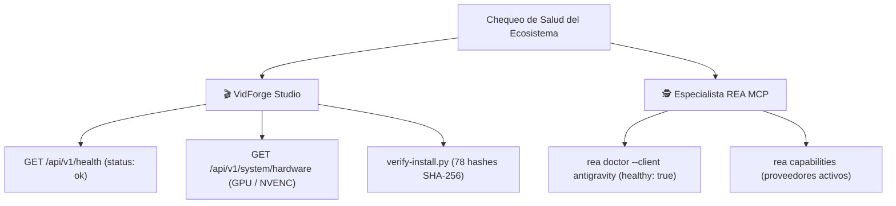

# 🩺 Monitoreo y diagnóstico

> [!abstract] En pocas palabras
> Cómo comprobar en menos de 1 minuto si **VidForge Studio** y el especialista **[[Glosario#REA|REA]]** están sanos, qué tarjeta gráfica y codificadores están activos, dónde se guardan los archivos temporales y cómo limpiarlos sin perder proyectos.

## 🗺️ Árbol de verificación de salud



## 🔎 1. Diagnóstico rápido de VidForge Studio

Con el servidor en marcha (`127.0.0.1:8765`), puedes revisar su estado desde la pestaña **5. Hardware & Claves** o ejecutando en PowerShell:

```powershell
# Comprueba que el servidor FastAPI responda y muestra el hardware/codificador activo
Invoke-RestMethod -Uri "http://127.0.0.1:8765/api/v1/health"
Invoke-RestMethod -Uri "http://127.0.0.1:8765/api/v1/system/hardware"
```

> [!example] Respuesta esperada de `/api/v1/system/hardware`
> ```json
> {
>   "cpu_cores_physical": 8,
>   "cpu_cores_logical": 16,
>   "ram_total_gb": 32.0,
>   "encoders": {
>     "h264_nvenc": true,
>     "h264_amf": false,
>     "h264_qsv": false,
>     "libx264": true
>   },
>   "preferred_encoder": "h264_nvenc"
> }
> ```

## 🔎 2. Diagnóstico rápido del Especialista REA en Windows

Ejecuta estos comandos en PowerShell desde `d:\rea-projects`:

```powershell
# 1. Salud del registro MCP y de la skill en Google Antigravity
npx.cmd -y rea-agents@6.5.0 doctor --client antigravity --json

# 2. Capacidades y motores activos en este equipo Windows
npx.cmd -y rea-agents@6.5.0 capabilities --json
```

## 🗂️ 3. Ubicación de bases de datos, cachés y temporales

| Ruta en `d:\rea-projects\vidforge\storage\` | Qué contiene | ¿Se puede borrar para liberar espacio? |
|---|---|---|
| `userdata/vidforge.db` | Índice [[Glosario#SQLite WAL\|SQLite WAL]] de proyectos, activos, transcripciones y ajustes | ⚠️ **No borrar** (contiene el índice de tus proyectos) |
| `userdata/secrets.v1.bin` y `.key` | Bóveda cifrada [[Glosario#DPAPI\|DPAPI]] + [[Glosario#AES-256-GCM\|AES-256-GCM]] de claves de API | ⚠️ **No borrar** salvo que quieras reiniciar las claves guardadas |
| `projects/*.vfproj/` | Carpetas de cada proyecto con sus guiones, audios, renders `.mp4` y exportaciones CapCut | ⚠️ Borrar solo desde la interfaz o API (`DELETE /api/v1/projects/{id}`) |
| `temp/` | Directorios efímeros de trabajo del [[Glosario#Sidecar\|Sidecar]] (`sc_*`, `gl_*`, `render_*`) | ✅ **Sí, seguro de limpiar** con `POST /api/v1/system/cleanup-temp` o el botón **Limpiar Temporales** |
| `logs/` | Registros de ejecución y diagnóstico local | ✅ Sí, se recrea automáticamente |

> [!info]- Detalle técnico (monitoreo de cola de trabajos y eventos SSE)
> - Para listar los últimos 100 trabajos y ver si alguno falló (`state == "failed"` y campo `error`):
>   `Invoke-RestMethod -Uri "http://127.0.0.1:8765/api/v1/jobs"`
> - Para cancelar un trabajo en curso o encolado:
>   `Invoke-RestMethod -Method Post -Uri "http://127.0.0.1:8765/api/v1/jobs/<job_id>/cancel"`

## 🚑 Cuándo acudir a los Runbooks

- Si un trabajo de tipo `render` o `motion_render` termina en estado `failed` → abre [[Runbook · Fallo en Sidecar o FFmpeg NVENC]].
- Si `rea doctor` reporta error o las herramientas `rea/*` no aparecen en el chat de Antigravity → abre [[Runbook · Herramientas MCP de REA no disponibles]].

## 🔗 Relacionado

- [[Operación]] · [[Runbook · Fallo en Sidecar o FFmpeg NVENC]] · [[Runbook · Herramientas MCP de REA no disponibles]] · [[Indicadores y métricas]]
