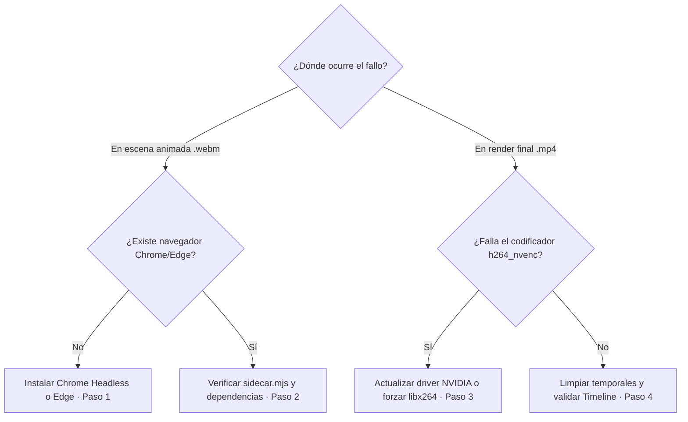

# 🚑 Runbook · Fallo en Sidecar o FFmpeg NVENC

> [!abstract] En pocas palabras
> Guía de emergencia paso a paso cuando **VidForge Studio** falla al renderizar una escena animada HTML/SVG (`.webm`) o al generar el vídeo final MP4 a 60 FPS (`Sidecar failed` o `FFmpeg failed`).

> [!danger] Síntoma
> El trabajo en segundo plano pasa a estado `failed` con mensajes como `Sidecar failed (rc=1)` o `FFmpeg failed (code 1)`, o la previsualización del render final no se genera.

| Severidad | Impacto | Escalar a | Tiempo máximo antes de escalar |
|---|---|---|---|
| 🟠 Media | No se pueden renderizar escenas animadas nuevas ni el MP4 final (la exportación a CapCut sigue funcionando) | **SebzSGC** (`sebzsgc@gmail.com`) | 15 min |

## 🔎 Diagnóstico rápido



## 🪜 Pasos de solución

### 1. Verificar las rutas de FFmpeg, Node.js y Chrome/Edge
Ejecuta este comando en PowerShell para comprobar qué binarios está resolviendo `infra/paths.py`:

```powershell
# Muestra las rutas exactas de FFmpeg, Node y Chrome que usa VidForge
d:\rea-projects\vidforge\runtime\venv\Scripts\python.exe -c "from vidforge.infra.paths import get_ffmpeg_path, get_node_path, get_chrome_path; print('FFmpeg:', get_ffmpeg_path()); print('Node:', get_node_path()); print('Chrome:', get_chrome_path())"
```

Esperado: Tres rutas existentes en disco (`runtime\ffmpeg\ffmpeg.exe`, `node.exe` y `chrome-headless-shell.exe` / `chrome.exe` / `msedge.exe`). Si falta `ffmpeg.exe` o `chrome-headless-shell.exe`, aprovisiónalos con:

```powershell
# Reaprovisiona los binarios locales del runtime
powershell -ExecutionPolicy Bypass -File "d:\rea-projects\vidforge\tools\fetch-runtimes.ps1"
```

### 2. Probar el Sidecar de Node.js de forma aislada
Comprueba que `puppeteer-core` esté instalado en `apps/render-sidecar` y que el test del sidecar pase:

```powershell
# Ejecuta la prueba automática del sidecar Node.js
node "d:\rea-projects\vidforge\apps\render-sidecar\test\sidecar.test.mjs"
```

Si faltara `node_modules` en `apps/render-sidecar`:
```powershell
npm.cmd --prefix "d:\rea-projects\vidforge\apps\render-sidecar" install
```

### 3. Comprobar el codificador GPU (`h264_nvenc`) vs CPU (`libx264`)
Verifica si el driver de NVIDIA acepta sesiones de codificación [[Glosario#NVENC|NVENC]]:

```powershell
# Consulta la detección en vivo de hardware y codificadores
d:\rea-projects\vidforge\runtime\venv\Scripts\python.exe -c "from vidforge.infra.hw import detect_hardware; import json; print(json.dumps(detect_hardware(), indent=2))"
```

Si `h264_nvenc` aparece en `false`, VidForge usa automáticamente `libx264` en CPU. Si el driver de NVIDIA se actualizó mientras el servidor estaba abierto, reinicia VidForge Studio para limpiar la caché `@lru_cache` de `detect_hardware()`.

### 4. Limpiar carpetas temporales e invariantes del Timeline
Si un corte manual dejó un clip con duración `0` o solapado:
1. En **5. Hardware & Claves**, pulsa **Limpiar Temporales** (`POST /api/v1/system/cleanup-temp`).
2. En **4. Editor Studio**, pulsa **Auto-Planificar Timeline** para regenerar los tramos sin solapes.

> [!warning] No hagas
> - **No borres `storage/userdata/vidforge.db`** para arreglar un fallo de renderizado: el problema está en el subproceso de vídeo o navegador, no en la base de datos.
> - **No mates `ffmpeg.exe` desde el Administrador de tareas mientras hay otro proyecto renderizando:** usa el botón **Cancelar** de la tarea (`POST /api/v1/jobs/{id}/cancel`).

## ✅ Cómo confirmar que se resolvió

Ejecuta la demostración de extremo a extremo o la suite de pruebas:

```powershell
# Verifica que el pipeline completo pase en verde
d:\rea-projects\vidforge\runtime\venv\Scripts\pytest.exe d:\rea-projects\vidforge\apps\backend\tests\test_vidforge_suite.py -k "render" -v
```

## 📝 Después del incidente

- Registra la causa y el arreglo en [[Historial de cambios]].

## 🔗 Relacionado

- [[Monitoreo y diagnóstico]] · [[Sidecar de Renderizado y Motor FFmpeg]] · [[Flujo de renderizado y escenas animadas]]
