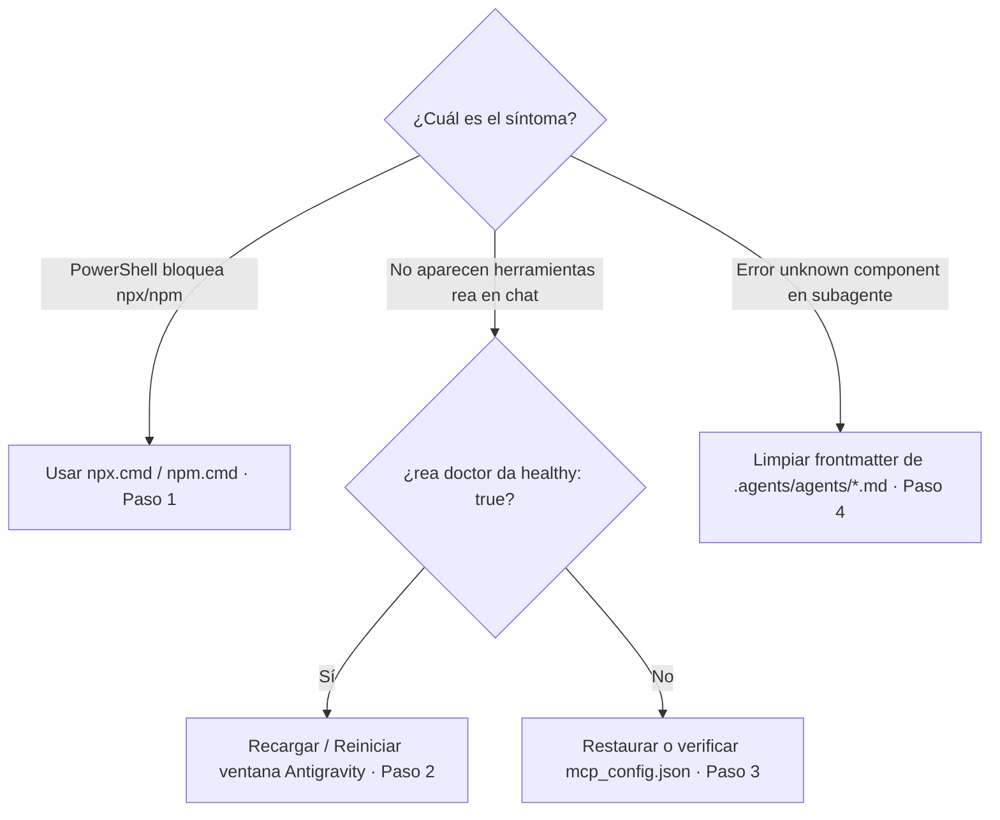

# 🚑 Runbook · Herramientas MCP de REA no disponibles

> [!abstract] En pocas palabras
> Qué hacer cuando las 207 herramientas del especialista **[[Glosario#REA|REA]] (`rea-agents@6.5.0`)** no aparecen en Google Antigravity, cuando PowerShell bloquea `npx.ps1` o cuando un subagente falla al iniciarse.

> [!danger] Síntoma
> El agente no muestra las herramientas `rea/*`, PowerShell devuelve `No se puede cargar el archivo ... npx.ps1 porque la ejecución de scripts está deshabilitada`, o un subagente termina con `unknown component: tool call_mcp_tool`.

| Severidad | Impacto | Escalar a | Tiempo máximo antes de escalar |
|---|---|---|---|
| 🟠 Media | No se pueden ejecutar inspecciones MCP de ingeniería inversa en la sesión activa | **SebzSGC** (`sebzsgc@gmail.com`) | 10 min |

## 🔎 Diagnóstico rápido



## 🪜 Pasos de solución

### 1. Auditar siempre con `npx.cmd` (principio "Diagnóstico antes de Reparación")
En Windows, PowerShell bloquea scripts `.ps1` sin firmar. Ejecuta primero el diagnóstico usando el ejecutable por lotes `.cmd`:

```powershell
# Diagnóstico oficial sin modificar ninguna configuración
npx.cmd -y rea-agents@6.5.0 doctor --client antigravity --json
```

Esperado: `"healthy": true` y `"registration:antigravity": "ok"`.

### 2. Recargar la sesión de Google Antigravity
Si `doctor` devuelve `"healthy": true` pero las herramientas no aparecen en el chat:
1. Google Antigravity lee `C:\Users\sebas\.gemini\config\mcp_config.json` únicamente al iniciar la sesión.
2. Cierra y vuelve a abrir la ventana de Google Antigravity para que el Language Server levante el proceso `stdio` de `rea`.

### 3. Verificar o restaurar `mcp_config.json`
Comprueba el contenido del archivo de registro global:

```powershell
# Muestra la configuración actual del servidor MCP rea
Get-Content "C:\Users\sebas\.gemini\config\mcp_config.json"
```

Debe contener:
```json
{
  "mcpServers": {
    "rea": {
      "command": "cmd.exe",
      "args": ["/d", "/c", "npx", "-y", "rea-agents@6.5.0", "mcp"]
    }
  }
}
```

Si necesitas revertir a la copia de seguridad original:
```powershell
Copy-Item "C:\Users\sebas\.gemini\config\mcp_config.json.rea.backup" -Destination "C:\Users\sebas\.gemini\config\mcp_config.json" -Force
```

### 4. Corregir error de inicialización en `.agents/agents/*.md`
Si al invocar `rea-agent` o `rea-specialist` aparece `failed to construct executor: unknown component: tool call_mcp_tool` o `Cannot resolve agent-relative path ... AgentBasePath is not set`:
1. Abre `d:\rea-projects\.agents\agents\rea-agent.md` y `rea-specialist.md`.
2. Asegúrate de que el frontmatter YAML **no** incluya `call_mcp_tool` en `tools:` ni un bloque `skills:` con rutas relativas (Antigravity ya inyecta las herramientas MCP y skills automáticamente).

> [!warning] No hagas
> - **No ejecutes `setup --yes` repetidamente si `doctor` ya reporta `healthy: true`** (principio de No Reinstalación Innecesaria).
> - **No intentes instalar Hopper Disassembler en Windows:** el aviso `unsupported_host` para `hopper` es esperado porque Hopper solo existe para macOS.

## ✅ Cómo confirmar que se resolvió

1. `npx.cmd -y rea-agents@6.5.0 doctor --client antigravity --json` devuelve `"healthy": true`.
2. En una nueva sesión de Antigravity están disponibles las herramientas `rea` (ej. `binary_session`, `analyze_javascript_application`, `inspect_pe_resources`).

## 📝 Después del incidente

- Documenta cualquier cambio de versión de Node.js o de REA en [[Historial de cambios]].

## 🔗 Relacionado

- [[Monitoreo y diagnóstico]] · [[Especialista REA y Auditoría Forense]] · [[Cómo auditar binarios con REA en Windows]] · [[ADR-003 Integración MCP de REA en Windows mediante wrappers cmd]]
