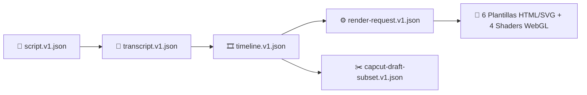

# 🎨 Catálogo de plantillas y contratos JSON

> [!abstract] En pocas palabras
> Inventario de las **6 plantillas animadas HTML/CSS/SVG**, los **4 efectos 3D [[Glosario#WebGL|WebGL]]** y los **9 contratos JSON Schema** que aseguran que todas las piezas de **VidForge Studio** hablen el mismo idioma sin errores ni datos inventados.

## 🗺️ Cómo se conectan los contratos y las plantillas



## 🎨 1. Catálogo de las 6 plantillas animadas (`packages/templates/`)

Cada plantilla vive en su propia carpeta con un `manifest.json` y un `index.html` que implementa `window.__vf.init(props, canvas)` y `window.__vf.seek(tMs)`:

| ID de Plantilla | Nombre visible | Categoría | Propiedades (`props`) | Reglas semánticas (*Fail-Closed*) |
|---|---|---|---|---|
| **`stat-highlight`** | Cifra / Estadística Destacada | `data` | `value` (*req*), `label` (*req*), `sublabel`, `accent` | `numbers_must_appear_in_speech` sobre `value` + `text_must_be_substring_fuzzy` (`0.4`) sobre `label` |
| **`lower-third`** | Lower Third / Presentación | `overlay` | `heading` (*req*), `subheading`, `accent` | `text_must_be_substring_fuzzy` (`0.4`) sobre `heading` |
| **`comparison-vs`** | Comparativa A vs B | `comparison` | `left_title` (*req*), `left_value`, `right_title` (*req*), `right_value`, `badge` | `requires_two_entities` (`left_title` y `right_title` obligatorios) |
| **`quote-callout`** | Cita / Frase Clave | `editorial` | `quote` (*req*), `author`, `role` | `text_must_be_substring_fuzzy` (`0.5`) sobre `quote` |
| **`timeline-steps`** | Proceso / Pasos Secuenciales | `process` | `title` (*req*), `steps` (*array de 2 a 5 textos*) | Validación de esquema JSON (mínimo 2 pasos) |
| **`trend-chart`** | Gráfico de Tendencia Animado | `data` | `title` (*req*), `values` (*array de 2 a 8 números*), `suffix` | `numbers_must_appear_in_speech` sobre `values` |

> [!example] Ejemplo de validación semántica en `stat-highlight`
> Si el locutor dice *"En el último año el rendimiento creció un 87%"* y pides renderizar `stat-highlight` con `{"value": "87%", "label": "Rendimiento anual"}`, la regla `numbers_must_appear_in_speech` comprueba que `"87"` aparece en el texto hablado y aprueba el render. Si por error envías `{"value": "95%"}`, el validador bloquea la petición con código `422` para impedir que el vídeo muestre una cifra falsa que contradiga al locutor.

## ✨ 2. Shaders WebGL de transición (`sidecar.mjs`)

El [[Glosario#Sidecar|Sidecar]] compila y ejecuta en GPU cuatro *fragment shaders* GLSL limpios (compatibles con MIT):

| Nombre del Shader | Efecto visual entre la Escena A y la Escena B |
|---|---|
| **`crosswarp`** | Deformación cruzada suave con interpolación `smoothstep` |
| **`directionalwarp`** | Barrido diagonal con estiramiento elástico hacia el centro |
| **`swirl`** | Remolino espiral en el centro del lienzo que gira y se desenrolla al cambiar de toma |
| **`ripple`** | Onda concéntrica tipo gota de agua sobre la imagen saliente |

## 📜 3. Los 9 Contratos JSON Schema (`packages/contracts/`)

| Archivo en `packages/contracts/` | Versión `$id` / `schema_version` | Qué valida |
|---|---|---|
| `project.v1.json` | `project/1` | Metadatos de `project.json` (`id`, `canvas`, `fps`, `providers`) |
| `script.v1.json` y `script.pydantic.v1.json` | `script/1` | Guion, personajes `@Tag` y lista de `BeatModel` |
| `transcript.v1.json` y `transcript.pydantic.v1.json` | `transcript/1` | Palabras alineadas (`start_us`, `end_us`, `source`) y segmentos |
| `timeline.v1.json` y `timeline.pydantic.v1.json` | `timeline/1` | Lienzo, estilos de subtítulos [[Glosario#ASS\|ASS]] y pistas multipista |
| `render-request.v1.json` | `vidforge.render/1` | Contrato de entrada entre Python y el Sidecar Node.js (`request.json`) |
| `capcut-draft-subset.v1.json` | `capcut-draft-subset/1` | Estructura de `draft_content.json` para [[Glosario#CapCut Desktop\|CapCut Desktop]] |

> [!info]- Detalle técnico (contrato JavaScript `window.__vf` para crear plantillas nuevas)
> Para agregar una séptima plantilla en `packages/templates/<mi-plantilla>/`:
> 1. Crea `manifest.json` con `id`, `name`, `version`, `schema` y `semantic_rules`.
> 2. Crea `index.html` exponiendo en `window.__vf`:
> ```javascript
> window.__vf = {
>   async init(props, canvas) {
>     // Inicializa textos, colores y dimensiones (canvas.width, canvas.height)
>   },
>   seek(tMs) {
>     // Calcula el progreso p = Math.min(1, tMs / durationMs) y actualiza estilos CSS/SVG
>   }
> };
> ```

## 🔗 Relacionado

- [[Sidecar de Renderizado y Motor FFmpeg]] · [[Alineador ASR y Planificador de Timeline]] · [[Flujo de renderizado y escenas animadas]] · [[Referencia API]]
