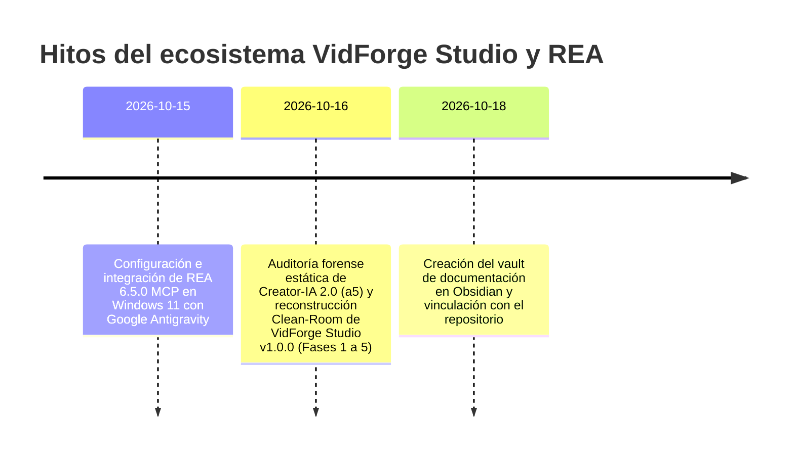

# 📝 Historial de cambios

> [!abstract] En pocas palabras
> Bitácora cronológica de qué cambió en el proyecto, cuándo se hizo y qué significa para quien usa o mantiene **VidForge Studio** y el entorno **[[Glosario#REA|REA]]**. Lo más reciente aparece arriba.

## 2026-10-18 · Documentación v1.0 (Vault Obsidian)

- ✨ **Nuevo:** Creación del vault completo **VidForge Studio** en `D:\Doc - Proyectos\VidForge Studio` bajo metodología Diátaxis + MOCs (visión general, arquitectura, componentes, flujos, modelo de datos, indicadores, guías, runbooks, ADRs y referencia API/contratos).
- ✨ **Nuevo:** Vinculación del repositorio de código (`d:\rea-projects\.obsidian-docs.json`) e inicialización del repositorio Git de documentación con hooks de validación y seguridad.
- ⚠️ **Cambia para ti:** Ahora puedes consultar cualquier flujo, comando o contrato desde `00 - Inicio.md` en Obsidian o desde el Dashboard HTML interactivo.

## 2026-10-16 · VidForge Studio v1.0.0 (Reconstrucción Clean-Room Fases 1 a 5)

- ✨ **Nuevo (Fase 1 - Runtime e Infraestructura):** Entorno aislado (`CPython 3.12.15`, `uv`, `FFmpeg`), gestión de subprocesos en Windows con [[Glosario#Job Object|Job Objects]] (`CREATE_NO_WINDOW`) y detección automática de GPU NVIDIA (`h264_nvenc`).
- ✨ **Nuevo (Fase 2 - Backend FastAPI, AudioLab y ASR):** Servidor REST + [[Glosario#SSE|SSE]] (`/api/v1/*`), `JobManager` con semáforos por recurso (`gpu`, `cpu`, `net`, `io`), [[Glosario#AudioLab|AudioLab]] (`join`, `trim_silence`, `normalize` a `-14 LUFS`), [[Glosario#Alineación forzada|alineación forzada]] palabra por palabra (`RapidFuzz` + Needleman-Wunsch) y bóveda cifrada con [[Glosario#DPAPI|DPAPI]] + [[Glosario#AES-256-GCM|AES-256-GCM]].
- ✨ **Nuevo (Fase 3 - Sidecar Node.js, Plantillas y Exportadores):** Motor `sidecar.mjs` con `puppeteer-core`, 6 plantillas HTML/CSS/SVG exportadas a WebM VP9 con canal alfa (`alpha_mode=1`), 4 shaders [[Glosario#WebGL|WebGL]] GLSL (`crosswarp`, `directionalwarp`, `swirl`, `ripple`), pipeline [[Glosario#Ken Burns|Ken Burns]] `1.5x` sin *jitter*, compensación matemática de [[Glosario#xfade|xfade]] y exportador validado para **[[Glosario#CapCut Desktop|CapCut Desktop]]** y **[[Glosario#OTIO|OTIO]]**.
- ✨ **Nuevo (Fase 4 - SPA React 18 y Lanzador Nativo):** Interfaz web con 5 estaciones de trabajo, modo **Autopilot 1-Click** y ventana nativa [[Glosario#WebView2|WebView2]] (`Iniciar-VidForge.bat`).
- ✨ **Nuevo (Fase 5 - Contratos, Verificador e Instalador):** 9 esquemas JSON Schema 2020-12, verificador SHA-256 (`verify-install.py` sobre 78 archivos), script [[Glosario#Inno Setup|Inno Setup]] (`vidforge.iss`) y suite de pruebas con `pytest` + `hypothesis`.
- 🔍 **Auditoría Forense (`01-generadorVideos`):** Extracción estática y verificación 100 % SHA-256 de los 207 artefactos de `Creator-IA 2.0 (a5)` y documentación de sus 193 rutas HTTP en `projects/01-generadorVideos/analisis/`.
- ⚠️ **Cambia para ti:** Dispones de los lanzadores `Iniciar-VidForge.bat` e `Iniciar-Servidor-Web.bat` para producir vídeos completos localmente sin depender de servidores externos.

## 2026-10-15 · Especialista REA en Windows v1.0 (`rea-agents@6.5.0`)

- ✨ **Nuevo:** Registro del servidor [[Glosario#MCP|MCP]] `rea` (`rea-agents@6.5.0`, skill v42, 207 herramientas) en Google Antigravity sobre Windows 11 mediante wrapper `cmd.exe /d /c npx`.
- ✨ **Nuevo:** Creación de las reglas operativas `AGENTS.md`, `GEMINI.md`, subagentes `rea-agent` / `rea-specialist` y skill local `rea-windows-specialist`.
- ⚠️ **Cambia para ti:** Antigravity cuenta con las 207 herramientas de ingeniería inversa de REA listas para inspeccionar binarios PE, `.NET` y aplicaciones JavaScript/Electron.

## 🔗 Relacionado

- [[00 - Inicio]] · [[Resumen ejecutivo]] · [[Decisiones]] · [[Despliegue e instalador]]
